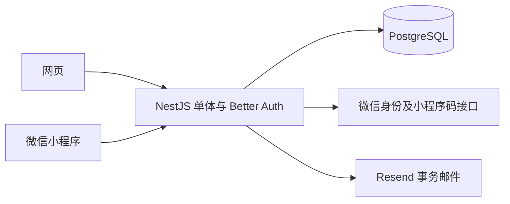

# 日序 Dayline 后端 Spec

| 项目 | 内容 |
| --- | --- |
| 版本 | v0.1 |
| 日期 | 2026-10-26 |
| 状态 | 后端实现规格草案；产品范围遵循已确认需求，工程默认值可在集成验证后调整 |
| 需求基线 | [requirements.md](requirements.md) v1.0 |
| 客户端 | Vue 网页与 uni-app 微信小程序 |
| 核心技术 | Node.js、NestJS、TypeScript、PostgreSQL、Prisma、Better Auth、Resend |
| 当前交付 | 邮箱 / 微信统一认证、扫码登录、第 6.6 节资料版本修改，以及第 9 / 10 节记录核心与完整快照已实现；文件、绑定合并和注销维护待后续阶段，证据见 [阶段 2 交接](stage2-handoff.md) |

阅读索引：

- [范围与结构](#1-规格效力与首版边界)
- [HTTP 契约](#3-http-与数据契约)
- [数据库模型](#4-数据库模型)
- [认证与会话](#6-认证会话与邮箱绑定)
- [扫码](#7-扫码登录与微信绑定)及[账号合并](#8-账号合并)
- [记录接口](#9-事项分类重点与回收站-api)及[完整读取](#10-完整快照与跨端刷新)
- [文件格式](#11-csv-与-json-文件契约)、[导入协议](#12-导入执行协议)及[游客接入](#13-游客数据接入)
- [注销与维护](#14-账号注销与清理任务)
- [前端契约](#17-提供给前端-spec-的固定契约)、[测试](#18-测试规格)及[实施顺序](#19-实施拆分与完成定义)

## 1. 规格效力与首版边界

### 1.1 约束优先级

1. 已确认需求和后续明确的需求变更。
2. 本文中的接口、业务不变量与数据保护要求。
3. 本文标为“工程默认”的参数和具体实现方式。

本文细化需求文档中的 T-01 至 T-09。工程默认不是新增的产品承诺，也不表示所选库的适配已经验证。遇到库能力不符时，先调整适配层；不得通过忽略权限、覆盖冲突数据或强迫微信用户填写邮箱来绕过问题。

### 1.2 首版必须提供

- 完整邮箱密码认证：注册、验证、重发、登录、密码重置、修改密码与退出。
- 微信小程序基础登录，同一应用 / 微信身份重复登录关联同一内部用户。
- 小程序确认网页登录，以及与登录意图区分的微信绑定。
- 未使用邮箱的绑定、双账号验证、数据预览与保留双方的账号合并。
- 分类、事项、每日重点、30 天回收站和版本冲突检查。
- 首次完整数据读取、后续前台全量刷新；不以整份客户端快照写回服务器。
- 游客登录时的本机数据接入，CSV / JSON 导入导出。
- 自助注销、7 天内撤销、到期清理，以及故障后的可重试处理。

### 1.3 明确排除

- Redis、微服务、消息中间件、专用离线同步引擎。
- 已登录账号的离线写入队列、自动补传、增量变更日志、WebSocket 推送。
- 后端存储网页草稿。网页草稿属于客户端本机状态，只有用户手动保存才提交。
- 组织 / 工作区 / 多人协作权限、公开动态、支付、AI 分析、原站专用迁移。
- 针对具体域名、服务器、备案或服务商的部署操作。

游客可在本机完整记录，后端只在登录后接收经确认的数据。游客本机保存不等于匿名调用私人业务 API，也不等于建立游客云端账号。

## 2. 应用结构与依赖边界

### 2.1 单体模块

```text
apps/api/src/
├── main.ts
├── app.module.ts
├── config/                 # 环境校验、参数默认值
├── common/                 # 错误、请求上下文、日期、输入校验
├── database/               # Prisma、事务、锁和迁移
├── auth/                   # Better Auth、微信适配、会话与重新验证
├── qr/                     # 扫码请求、确认、领取与取消
├── users/                  # 用户资料、账号状态、注销
├── categories/
├── entries/                # 含重点和回收站
├── snapshot/               # 完整一致读取、ETag
├── imports/                # CSV、JSON、游客接入
├── exports/
├── account-merges/         # 预览、执行、记录映射
├── maintenance/            # 到期扫描、清理
├── mail/                   # Resend 适配
└── health/

packages/contracts/         # 跨端 DTO、错误码、纯校验 schema
packages/core/              # 纯日期、范围、状态及统计规则
```



控制器负责 HTTP 和身份上下文，应用服务负责业务流程，数据库层负责有归属条件的查询和事务。不得在公共包引入 Prisma Client、Better Auth 服务端实例或密钥。

工程默认使用 NestJS 的 Express 适配。Better Auth 的 NestJS 集成由社区维护；先验证路由、原始请求体及普通 JSON / 文件解析的组合，不能关闭全局解析后漏掉业务接口解析。

### 2.2 外部适配器

| 适配器 | 职责 | 禁止外泄 |
| --- | --- | --- |
| `AuthAdapter` | 标准认证、受控创建会话、验证会话、重新验证、撤销会话、凭据迁移 | 密码哈希、内部用户邮箱标识、会话 token |
| `WechatAdapter` | code 换身份、获取所需应用凭据、生成小程序码 | app secret、session_key、应用 access token |
| `MailAdapter` | 发送验证与重置等事务邮件，返回提供商处理结果 | Resend API key、完整验证链接 |
| `Clock` | UTC 当前时间与北京时间业务日期，可替换以测试 | 不读取客户端声明的“今天”作为依据 |

`WechatAdapter` 接收的是配置的应用和微信 code，不接受客户端直接提交的 OpenID 作为身份证明。外部 HTTP 调用默认设置超时；不可在持有业务写锁时等待微信或邮件服务。

### 2.3 数据访问不变量

- 每条私人数据的访问都从可信 `Actor.userId` 开始。
- 业务查询不得只按记录 ID 读取再盲目返回；必须附加所属用户条件或通过已校验的所属关系查询。
- 来源账号映射仅在已完成、双方已验证的账号合并中使用，普通登录不自动沿用别人的数据。
- 不向客户端开放 Prisma 任意模型查询或通用批量 upsert。
- 身份变更、导入、合并等流程的状态保存在 PostgreSQL；进程重启不能把一半处理当作成功。

## 3. HTTP 与数据契约

### 3.1 路由和认证分区

- 业务 API 基路径：`/api/v1`。
- Better Auth 标准端点：`/api/auth`，返回其原生协议，由认证客户端适配，不强行包装成业务响应。
- 自定义扫码、微信登录、绑定等业务编排端点：`/api/v1/auth`，可在内部调用认证插件能力。
- 所有业务接口默认为必须登录；允许匿名的接口在路由表逐项标注。
- `/health/live` 只检查进程；`/health/ready` 检查数据库连接及迁移是否满足运行要求，不探测微信和 Resend 来阻塞所有业务。

网页使用 HttpOnly 安全 Cookie；小程序使用受支持的 Better Auth Bearer 会话适配。两种传输最终得到同一 `Actor`，不是两套业务权限。

```ts
type Actor = {
  userId: string;
  sessionId: string;
  transport: 'cookie' | 'bearer';
  authEpoch: number;
};
```

拒绝一个请求中指向不同身份的 Cookie / Bearer 组合，不通过选择其中一个来静默切换用户。

配合前端 Spec，已知用户上下文的业务请求携带 `X-Dayline-Expected-User`，业务写请求必须提供；首次 `/me` 探测和明确匿名的注册、登录、验证、密码重置等接口例外。Guard 在验证真实会话后比较该 header，缺失的必要上下文返回 400 `ACTOR_CONTEXT_REQUIRED`，与会话不符返回 409 `ACTOR_CONTEXT_MISMATCH`，不执行写入。已登录的改密码、退出、重新验证等原生或自定义接口也由认证适配器校验，不能因为路由位于 auth 下就全部豁免。此值只是一致性保护，不能用于授权或选择用户；用于阻止另一标签页切换 Cookie 后把旧账号草稿写给新账号。

### 3.2 JSON 约定

| 类型 | 约定 |
| --- | --- |
| 业务记录 ID | UUID 字符串；认证模型的物理类型由集成验证统一 |
| 日历日期 | 严格 `YYYY-MM-DD`，有效年份 0001–9999，不接受自动溢出成下月 |
| 操作时间 | UTC RFC 3339，例 `2026-10-26T08:00:00.000Z` |
| 实体 `version` | 从 1 开始的正整数，服务器递增，客户端不能指定新值 |
| 用户 `dataVersion` | 数据库 bigint，JSON 使用十进制字符串，避免 JavaScript 精度损失 |
| 空结束日期 | JSON `null`；省略字段在 PATCH 中表示不修改 |
| 日期规则 | `timeZone: "Asia/Shanghai"`，不开放用户自定义时区 |
| 文本 | 去除业务字段首尾空白；长度按 Unicode 码点统一计算 |

请求 DTO 严格校验，不允许通过额外字段修改 `userId`、版本、删除时间、账号状态或凭据。导入文件中的原始元数据按导入规则解释，不构成更新所有者的权限。

### 3.3 业务响应

```json
{
  "data": {
    "id": "16e31354-ac7d-4d68-898c-eae9ec28bb5e",
    "title": "阅读三体",
    "version": 3
  },
  "meta": {
    "requestId": "01JDAYLINEEXAMPLE",
    "serverTime": "2026-10-26T08:00:00.000Z"
  }
}
```

```json
{
  "error": {
    "code": "VERSION_CONFLICT",
    "message": "记录已有更新，请核对后再次保存。",
    "details": {
      "entryId": "16e31354-ac7d-4d68-898c-eae9ec28bb5e",
      "expectedVersion": 2,
      "currentVersion": 3
    }
  },
  "meta": {
    "requestId": "01JDAYLINEEXAMPLE",
    "serverTime": "2026-10-26T08:00:00.000Z"
  }
}
```

`requestId` 只用于排查，不作为幂等凭据。已验证拥有记录后，冲突响应可包含当前记录；跨用户请求统一返回不泄露存在性的 404。

普通业务写成功的 `meta` 另含本次提交后的 `dataVersion`；返回事项时使用完整 `EntryDto`，涉及重点时一并返回相应状态。客户端可据此丢弃早于该次写入的旧快照，十进制版本不能按普通字符串字典序比较。恢复后的重新登录 / 首次完整加载以服务器基线为准，不用旧本机版本永久拒绝服务器数据。

### 3.4 通用状态码

| HTTP | 场景 |
| --- | --- |
| 200 / 201 | 已完成读取 / 更新 / 创建；成功状态必须在事务提交后返回 |
| 202 | 已记录等待确认的操作或返回通用邮件申请结果，不表示数据已导入 / 合并 |
| 204 | 无响应体的成功操作 |
| 304 | 完整数据 ETag 未变化；仍须先验证当前身份和账号状态 |
| 400 | JSON / 参数语法不合法 |
| 401 | 缺失、失效、已撤销或 epoch 过期的会话 |
| 403 | 待注销等状态禁止当前操作，或需要重新验证 |
| 404 | 不存在或不属于当前用户的资源 |
| 409 | 版本、预览、身份关联或请求状态冲突 |
| 410 | 当前用户已知且有权访问的回收站 / 短期请求已过期 |
| 413 | 单次请求或导入超过工程限制；不能静默截断 |
| 422 | 日期、引用、文件行等业务校验失败 |
| 429 | 频率限制，带 `Retry-After` |
| 502 / 503 | 必要外部依赖失败 / 暂时不可用；不返回内部堆栈 |

### 3.5 API 兼容性

微信原生 request 不支持 PATCH，平台适配器将它封装为 POST 并附 `X-Dayline-Method-Override: PATCH`。服务器仅对 pathname 位于 `/api/v1/` 的 POST 且 header 精确等于 `PATCH` 时，在路由 / Guard 前改写 method；原鉴权、Origin、预期账号和 DTO 校验继续执行。普通 POST / GET、其他 header 值及 `/api/auth` 均不改写。CORS 允许该 header。这是传输兼容机制，不增加匿名或绕过校验的业务接口。

小程序可能较晚更新，`v1` 内保持字段与语义兼容。新增可选响应字段不要求同时发版；删除或改变必填字段需新版本。所有规范 DTO 写入 `packages/contracts`，再由接口实现生成或验证 OpenAPI；本文不是已经生成的 OpenAPI 文件。

## 4. 数据库模型

### 4.1 统一用户与认证模型

首选以一个内部 UUID 贯穿业务用户和 Better Auth 用户，不在业务中使用邮箱、OpenID 或设备 ID 作为主键。

无邮箱微信用户的工程默认方案：自定义认证插件创建唯一的内部邮箱占位标识，例如 `wx-<random-uuid>@identity.dayline.invalid`，`emailVerified=false`，另有 `emailKind=internal`。它不是用户的真实邮箱，不发送邮件，不开放密码登录 / 找回密码，不通过 API 展示为已绑定邮箱。公开注册禁止使用内部保留后缀。

阶段 1 已通过服务端插件、签名会话和真实 PostgreSQL 集成测试验证无邮箱身份与后续邮箱 / 密码设置保持同一用户 ID；完整绑定产品流程尚未开放。Gate-A 的真实微信和邮件投递仍待凭据验证。若不相容，则改为业务用户与认证用户受控映射，并在首个正式迁移前修订本节；不得伪造邮箱已验证，也不得把微信用户挡在邮箱注册之后。

Better Auth 的 `user / account / session / verification` 模型由锁定版本生成，再映射为本项目表名。禁止靠本文手写的简表猜测库必需字段，或同时运行两套互相竞争的迁移工具。

### 4.2 `users`

除库生成的必需字段外，增加以下业务字段；若 Gate-A 采用分离模型，则放在业务用户表。

| 字段 | 类型 / 默认 | 说明 |
| --- | --- | --- |
| `id` | UUID PK | 内部用户 ID |
| `name` | text | 显示名，工程默认 1–40 码点 |
| `email_kind` | `real / internal` | 真实邮箱或内部占位标识；不可由客户端修改 |
| `status` | `active / pending_deletion / merged` | 删除到期后物理清理，合并来源保留受控映射壳 |
| `auth_epoch` | integer，1 | 绑定、合并、注销等导致旧会话失效时递增 |
| `data_version` | bigint，1 | 完整业务快照版本；不是增量游标或变更日志 |
| `profile_version` | integer，1 | 显示名等资料的并发版本 |
| `initialized_at` | timestamptz nullable | 默认业务结构完整初始化成功的标记 |
| `deletion_requested_at` | timestamptz nullable | 申请注销时间 |
| `deletion_due_at` | timestamptz nullable | 请求确认后 7 × 24 小时 |
| `merged_into_user_id` | UUID FK nullable | 合并后的目标账号，不作为绕过验证的自动登录入口 |
| `created_at / updated_at` | timestamptz | 服务器维护 |

索引：主键；待注销用户的 `(status, deletion_due_at)`；合并目标外键索引。真实邮箱规范化、唯一性及变更由认证适配器配合库模型实现，不对任意邮箱删除 `+tag` 或 Gmail 的点号。

`data_version` 在业务内容真正变化时递增一次，包括分类、事项、重点、回收站、导入、合并和后台清理；无变化请求不递增。不用它恢复历史，也不需要 `user_sync_state` 表。

### 4.3 `auth_accounts / auth_sessions / auth_verifications`

- `auth_accounts`：库管理的 provider、凭据及哈希；微信 OpenID 的唯一业务绑定放在专用身份表，不能与另一份可独立登录的记录失去一致性。
- `auth_sessions`：库管理的 token、有效期及用户；通过插件增加会话创建时的 `auth_epoch` 和登录方法，或提供等价的服务端校验。
- `auth_verifications`：库管理的验证和重置记录；不得把明文密码写入其中。
- 密码哈希算法、加盐和验证使用 Better Auth 支持的机制；不自建密码哈希流程。
- 禁用会绕过账号实时状态检查的无状态会话 / Cookie 用户缓存，业务 Guard 每次确认用户状态和 epoch。

允许邮箱密码与微信会话并存，但所有有效会话都必须对应同一个用户归属。认证模型原始响应不能直接作为 `/me` 的公开 DTO。

### 4.4 `wechat_identities`

| 字段 | 类型 | 说明 |
| --- | --- | --- |
| `id` | UUID PK | 关联记录 ID |
| `user_id` | UUID FK | 所属用户 |
| `app_id` | text | 服务端配置的微信应用 |
| `openid` | text | 只由 code 交换结果写入 |
| `unionid` | text nullable | 可空，不作为首版必要条件 |
| `created_at / updated_at` | timestamptz | 服务器维护 |

唯一约束：`(app_id, openid)`；首版每个用户在同一应用最多一个微信身份，约束 `(user_id, app_id)`。UnionID 不设跨应用自动合并逻辑。删除用户或移动身份必须在账号服务的受控事务中进行。

### 4.5 `categories`

| 字段 | 类型 | 说明 |
| --- | --- | --- |
| `id / user_id` | UUID | 主键与所属用户 |
| `name` | text | 去首尾空白，1–12 码点，当前账号内唯一 |
| `color` | text | 规范化为 `#RRGGBB` |
| `seed_key` | text nullable | 六个默认分类的稳定语义标识；用户新建为空 |
| `version` | integer | 初始 1 |
| `created_at / updated_at` | timestamptz | 服务器维护 |

唯一约束 `(user_id, name)`、`(id, user_id)`，默认分类另有 `(user_id, seed_key)` 的非空唯一约束。工程默认每用户最多 20 个分类且至少保留一个。

六个默认分类沿用原站第 9 版 `public/core.mjs` 的 `DEFAULT_CATEGORIES`，统一常量如下。颜色规范化为大写不改变实际颜色；记录 ID 使用各账号 UUID，不把 seed key 当全局记录主键。

| seed key | 名称 | 颜色 |
| --- | --- | --- |
| `game` | 游戏 | `#8B80D8` |
| `reading` | 阅读 | `#6C9BCE` |
| `work` | 工作 | `#D6A063` |
| `sport` | 运动 | `#6CA58A` |
| `life` | 生活 | `#B88EAA` |
| `other` | 其他 | `#A0A4B3` |

默认值只用于首次建号，不在每次登录时重建或覆盖自定义内容。阶段 2 使用 users AFTER INSERT 触发器实现跨邮箱 / 微信创建路径的同事务初始化不变量，六分类与 initialized_at 一起提交 / 回滚；迁移以显式 BEGIN / COMMIT 原子处理已有账号的分类与标记回填。此设计避开 Better Auth adapter 事务中通过根 Prisma hook 查询未提交用户造成的阻塞；登录和 GET 不执行初始化。

### 4.6 `entries`

| 字段 | 类型 | 说明 |
| --- | --- | --- |
| `id / user_id` | UUID | 主键与所属用户 |
| `category_id` | UUID | 指向同一用户的分类 |
| `title` | text | 去首尾空白，1–100 码点 |
| `start_date` | date | 必填，允许未来 |
| `end_date` | date nullable | 不早于开始日期 |
| `version` | integer，1 | 标题、日期、分类、删除 / 恢复等内容版本 |
| `focus_version` | integer，1 | 重点集合版本，供完整导入更新检查 |
| `deleted_at` | timestamptz nullable | 软删除时间 |
| `purge_after` | timestamptz nullable | 回收站到期时间 |
| `created_at / updated_at` | timestamptz | 服务器维护 |

约束：`end_date IS NULL OR end_date >= start_date`；删除时间与清理时间同时为空或同时非空；分类使用复合外键 `(category_id, user_id)`。

索引：`(user_id, start_date, id)`；`(user_id, category_id)`；`(user_id, deleted_at)`；对已删除记录的 `purge_after` 建清理索引。不单独持久化进行中状态、持续天数或统计总数。

### 4.7 `entry_focus_days`

| 字段 | 类型 | 说明 |
| --- | --- | --- |
| `entry_id / date` | UUID + date，复合 PK | 归属通过事项确定 |
| `focused` | boolean | 明确的重点状态，不使用翻转操作 |
| `version` | integer，1 | 此事项此日期的状态版本 |
| `updated_at` | timestamptz | 服务器维护 |

取消后保留 `focused=false` 和版本，直至事项永久清理，以识别旧页面的再次提交；这仍是业务重点状态，不是独立同步日志。未出现的日期逻辑状态为 `focused=false, version=0`。

同一事项不同日期的操作独立校验，因此手机增加 10 月 25 日重点、网页增加 10 月 26 日重点可以同时成功。重点操作增加事项的 `focus_version`，不因另一日期的重点变化而增加事项内容 `version`。

真实重点必须满足：事项未删除，日期不晚于北京时间今天，并处于事项起止区间。跨表业务约束在锁定所属用户和事项后校验。事项永久清理时级联清理重点。

### 4.8 `qr_requests`

主要字段：`id`、`purpose=login|bind_wechat`、`initiator_user_id?`、`initiator_auth_epoch?`、`browser_binding_hash`、`scan_token_hash`、`status`、`candidate_user_id?`、仅服务端可读的已验证微信身份、确认凭据摘要、`expires_at`、`confirmed_at?`、`consumed_at?`、`created_at`。

状态及消费规则见第 7 节。扫码 scene 使用短随机 token，例如 16 随机字节的 base64url，满足微信 scene 长度限制；不能直接塞入长 JSON、账号 ID 或会话 token。浏览器绑定 secret 与扫码 token 分开，数据库保存摘要。

### 4.9 `email_binding_requests`

该表属于自定义绑定插件，不替代 Better Auth 的标准注册验证。

字段：`id`、`user_id`、`normalized_email`、`token_hash`、`status=pending|verified|consumed|cancelled`、`expires_at`、`verified_at?`、`created_at`。

用于微信用户添加未使用邮箱，或验证邮箱已属于另一账号后进入合并。只在同时证明当前账号和目标邮箱控制权后改变关联。原始链接 token 只出现在邮件和用户点击的请求中，数据库存摘要；响应、日志及导入导出均不得包含它。

### 4.10 `import_jobs`

| 字段组 | 内容 |
| --- | --- |
| 身份 | `id`、`user_id`、`kind`（guest / csv / json）、`client_operation_id` |
| 输入标识 | 规范化输入摘要、格式版本、必要的文件摘要 |
| 状态 | preview / committed / cancelled / expired |
| 预览 | 基准 `data_version`、`plan_revision`、归一化输入、逐行计划、冲突、用户确认选项 |
| 结果 | 导入计数、稳定的源项到目标 ID 映射、完成时间 |
| 保留 | 预览过期时间、私密输入清理时间 |

唯一约束 `(user_id, client_operation_id)`。同一标识不同请求内容返回 `IDEMPOTENCY_KEY_REUSED`。已完成任务的最小摘要和映射保留至账号清理，完整原文件 / 归一化私密输入按短期策略删除，避免长期复制全部历史文件。

### 4.11 `account_merges / merge_record_mappings`

`account_merges`：`id`、`initiator_user_id`、`source_user_id`、`target_user_id`、`client_operation_id`、双方证明及 epoch 绑定信息、`source_data_version`、`target_data_version`、`plan_revision`、预览及恢复快照、`status=preview|committed|cancelled|expired`、执行结果、到期及完成时间。

`merge_record_mappings`：`merge_id`、实体类型、来源用户 / 来源记录标识、目标用户 / 目标记录标识。对同一次合并的来源键唯一，避免重试产生不同映射；可包含原 ID 与新 ID 相同但所属用户变化的情况。

映射只向已验证的统一账号开放，不能凭来源用户 ID 查询。必要映射保留至统一账号删除，合并恢复快照工程默认保留 7 天，限制访问并到期清理。未实现面向用户的一键撤销合并功能，不应在前端承诺。

### 4.12 明确不建立的表

首版不建 `user_sync_state`、`sync_changes`、普通 CRUD 的 `mutation_receipts`、草稿表、统计表或回收站副本表。导入、合并、绑定及二维码的有限状态记录用于具体业务操作，不作为重新引入离线队列的借口。

## 5. 事务、版本与竞争条件

### 5.1 写入顺序

工程默认：所有影响账号内容的写入，在事务中先锁所属 `users` 行，重新检查账号状态，再操作记录并增加 `data_version`。单账号写入串行，不同账号互不共用一把锁；符合首版的小规模在线写入场景。

跨账号合并按用户 UUID 的固定顺序锁两行，降低死锁风险。所有业务写接口和清理任务必须遵循同一顺序，不能只有导入服务加锁、普通事项服务不加锁。

外部调用、文件解析和大规模预览在事务外完成；事务内仅重新校验依据和提交计划。任何成功响应均在提交后返回。

### 5.2 普通修改

客户端提交 `expectedVersion`。后端在归属检查后执行原子版本比较：不一致返回 409，不改变任何字段；一致才更新并递增版本。

没有可靠基准的草稿不能按时间戳强行覆盖。`updatedAt` 用于展示，不作为并发控制凭据。接口不提供 `force=true` 绕过版本检查。

### 5.3 新增与响应丢失

客户端为一次新建生成稳定 UUID，多次点击或同次失败重试保持同一个 ID。已存在且属于当前用户时返回明确的 `alreadyExists` / 当前记录，或在内容不一致时返回冲突；不再次插入，也不修改已有内容。

若该 ID 属于他人，只返回不可用的通用冲突，不泄露他人的记录。不能通过有 ID 就 upsert 达到“重试”目的。

更新响应丢失后客户端读取当前记录核对；旧版本再次提交可返回冲突，不必为了返回完全相同的 HTTP 响应而增加通用回执表。

### 5.4 完整读取一致性

完整快照在同一只读一致事务中读取用户 `data_version`、分类、事项及重点，工程默认 PostgreSQL `REPEATABLE READ`。不得把不同事务读到的分类和事项拼成一个错误引用的快照。

`data_version` 与内容写入在同一事务提交，快照 ETag 由用户、数据版本、格式版本和业务日期构成。它只验证整份快照是否变化，不支持从某版本拉取变更。

### 5.5 特殊操作

- 分类删除与事项转移、事项缩短范围与重点移除、恢复与回收站状态更新必须原子执行。
- 预览不写业务数据；导入 / 合并执行时重新验证预览版本与选项，一旦变化返回 `PREVIEW_STALE`，不得提交旧计划。
- 已完成导入 / 合并的重试直接返回已存结果；数据库回滚后任务仍可重新执行，不允许持久化成“成功但只完成一部分”。
- 不进行以用户缓存为输入的全量覆盖更新，也不从客户端提交的 `userId` 确定写入目标。

## 6. 认证、会话与邮箱绑定

### 6.1 集成验收 Gate-A

在事项 API 全面开发前，必须完成以下最小验证并记录所选确切版本：

1. NestJS 与 Better Auth 路由、JSON / multipart 请求体可共存。
2. Prisma 生成 / 迁移后的用户、凭据、会话和验证模型与库一致。
3. 邮箱注册、真实邮件验证、密码登录和重置可用。
4. 无真实邮箱的微信用户可建立同一体系内的会话，`/me` 的邮箱仍为 null。
5. Cookie 与小程序原生请求的 Bearer 都能通过同一 Guard；不依赖小程序能运行浏览器 SDK。
6. 自定义端点能通过受支持的插件 / 适配方式创建会话和 Cookie，微信身份创建具备唯一性及失败恢复。
7. epoch 更新、退出、密码重置、合并和注销后，旧会话确实不能继续写入。
8. 微信用户添加真实邮箱并设置密码后，使用邮箱登录得到原用户 ID。

Gate-A 的本地技术验证已覆盖无邮箱微信、Cookie / 签名 Bearer、身份并发与邮箱密码迁移，真实微信 / Resend 与真机尚未执行，见 `stage1-handoff.md`。集成中需要使用的库内部能力必须封装在 `AuthAdapter`；不允许多个业务服务各自直接调用不稳定内部 API。

### 6.2 标准邮箱端点

以下使用 Better Auth 原生路径和协议，安装版本以实际生成契约为准：

| 方法 | 路径 | 用途 |
| --- | --- | --- |
| POST | `/api/auth/sign-up/email` | 注册，创建待验证邮箱身份，不开放私人业务会话 |
| POST | `/api/auth/send-verification-email` | 受限频率重发验证邮件 |
| GET | `/api/auth/verify-email` | 验证一次性链接，按认证配置进入登录或建立会话 |
| POST | `/api/auth/sign-in/email` | 已验证邮箱及密码登录 |
| POST | `/api/auth/request-password-reset` | 通用找回响应，不暴露邮箱是否存在 |
| POST | `/api/auth/reset-password` | 消费有效重置凭据并设置新密码 |
| POST | `/api/auth/change-password` | 有会话及当前密码的标准密码修改 |
| POST | `/api/auth/sign-out` | 退出当前会话 |
| GET | `/api/auth/get-session` | 认证 SDK 使用的会话读取 |

通过配置、插件或路由策略限制未使用的认证功能。不得启用认证库的自动同邮箱账号关联、任意社交 provider 绑定、即时用户删除或不受业务状态约束的资料修改来绕过本文流程。

邮箱密码工程默认：8–128 字符，使用库默认的受支持哈希机制；邮箱登录要求 `emailVerified=true` 且 `emailKind=real`。微信验证产生的会话不以真实邮箱验证为前提，两种登录方法必须在适配器中明确区分。

注册和首次微信建号创建默认分类，使用幂等初始化，不能因认证回调重放产生第二套分类。六个分类与 `initialized_at` 在同一事务内写入；业务接口拒绝未初始化状态，登录适配流程重试初始化后再完成可用会话。不能靠“分类不足六个”判断需要补齐，否则会覆盖用户后来主动删除或修改的默认分类。失败后重试不能让用户永久停留在部分初始化状态。

### 6.3 微信登录

`POST /api/v1/auth/wechat/login`，匿名允许，受限频率。

```json
{
  "code": "temporary-wechat-code"
}
```

流程：校验请求 → 服务端使用配置应用交换 code → 查找 `(app_id, openid)` → 建号或取得已有用户 → 检查账号状态 → 创建本系统会话。

首次并发登录通过身份唯一约束收敛到同一用户；不得把 code 失败自动降级成未验证用户。微信 code 不长存、不写日志、不当作下次登录凭据。重复使用失效 code 时客户端需重新获取，而不是持续重试原 code。

成功返回公开 `UserDto`、会话有效期及小程序所需的受支持 Bearer 凭据。具体 token 签名格式与取得方式在 Gate-A 固定；不能生成一串 UUID 后仅凭格式合法就通过认证。

扫码绑定使用第 7 节的专用解析流程，不应先调用本接口为未知微信强制创建空账号，再设法合并。

### 6.4 会话策略

- 工程默认有效期 7 天，活跃时按 24 小时更新间隔续期，采用所选库支持的滑动会话配置。
- 网页使用 `Secure + HttpOnly + SameSite=Lax` 的主会话 Cookie；同源反向代理即可，工程独立不要求公开跨域。
- 小程序凭据只保存在受控平台存储并在请求适配器加入 Authorization，不出现在 URL、二维码或通用数据缓存 / 备份中。
- 业务 Guard 通过认证库验证会话，再读取用户状态和 epoch。缺失 epoch、账号已合并或 epoch 过期必须拒绝，不能把客户端自报的 epoch 当作依据。
- 当前会话退出不影响其他设备；密码重置工程默认撤销全部旧会话，修改密码允许按既定策略撤销其他会话，均须测试。
- 绑定和合并后更新 epoch、撤销受影响旧会话；返回明确的重新登录要求。完成操作的响应不应被前端误当成操作失败后丢弃草稿。
- 若 Bearer 插件要求签名，使用它支持的签名格式，不能自行假定 Cookie 原值与原始数据库 token 完全等价。

### 6.5 重新验证与操作证明

`POST /api/v1/auth/reauth` 接收 `purpose`、`operationId`，以及当前账号支持的密码或新的微信 code。服务端验证身份后签发短期操作证明，工程默认 5 分钟。

证明绑定用户、当前会话、epoch、操作意图和操作 UUID；只用于绑定、合并、注销等指定操作，不作为登录 token。可以使用独立密钥签名的短期结构，最终一次性效果由二维码 / 绑定 / 合并记录或账号状态转移消费。

重要约束：

- 证明不能用于另一个目标、另一种操作或另一会话；操作 UUID / 目标身份也参与验证。
- epoch 变化后证明失效；注销撤销等状态变化也更新 epoch，防止重放旧注销请求。
- 需要证明对方账号时，必须取得对方新验证结果，不能用当前账号证明覆盖双方。
- 验证失败限流；错误不回显密码、code 或原始证明。

### 6.6 `/me` 与资料

`GET /api/v1/me` 返回：`id`、`displayName`、`profileVersion`、真实邮箱或 null、邮箱是否验证、`passwordEnabled`、微信是否已绑定、账号状态、注销到期时间、固定时区。微信显示仅提供必要的绑定状态，不返回 OpenID / UnionID。

`PATCH /api/v1/me` 只接受 `{displayName, expectedProfileVersion}`，共享严格 schema 校验 1–40 个 Unicode 码点。锁定用户后再次检查 epoch / active 状态与资料版本，版本不符返回 409 VERSION_CONFLICT；同名无变化不递增版本，成功返回公开 UserDto。资料修改不改变业务 dataVersion。Cookie Origin、预期账号与小程序 method override 均沿用同一保护路由。不允许在这里更改邮箱、微信、状态或时区。

`POST /api/v1/auth/logout` 提供跨端一致的业务退出入口，内部调用认证适配器撤销当前会话，并清理网页 Cookie 或通知小程序清除凭据。

### 6.7 微信账号添加邮箱

| 方法 | 路径 | 输入 / 行为 |
| --- | --- | --- |
| POST | `/api/v1/me/email-binding-requests` | 邮箱、操作 UUID、当前账号重新验证证明；发送绑定邮件 |
| POST | `/api/v1/me/email-binding-requests/verify` | 绑定请求 ID、邮件 token；允许匿名验证链接，但只标记验证成功，不返回账号数据或改变关联 |
| POST | `/api/v1/me/email-binding-requests/{id}/complete` | 有效双方证明、操作选项及新密码；仅未占用邮箱可直接绑定 |
| DELETE | `/api/v1/me/email-binding-requests/{id}` | 取消未消费请求 |

邮箱未知 / 已注册在发送阶段都返回相同类型的结果。邮箱内容、验证成功及当前账号证明完成之前，不展示另一账号数据概要。

邮件可在另一设备打开，因此链接验证本身不要求原设备 Cookie；最终完成必须重新登录原发起账号并提供有效证明。不能凭已验证邮件链接直接登录或改绑当前浏览器里的其他账号。

- 邮箱未占用：验证后以当前用户设置真实邮箱和密码凭据，保持用户 ID 与数据归属；内部占位邮箱被替换，不额外创建空业务账号。
- 邮箱属于当前用户：幂等提示已绑定，按需要设置密码，不重复创建凭据。
- 邮箱属于其他用户：返回 `merge_required` 的受验证上下文，进入第 8 节；不直接把邮箱关联移走。
- 当前账号已有另一真实邮箱：首版不支持无限添加多个邮箱，返回明确的能力边界，不能覆盖已有邮箱。
- 验证后到完成前发生注册 / 绑定竞争：再次检查唯一性，重新进入冲突处理，不能依靠旧查询结果提交。

密码设置和凭据修改委托 `AuthAdapter`，使用库支持的密码设置 / 验证机制。默认不额外提供任意邮箱解绑、微信解绑或更换唯一登录方式的通用接口，避免失去全部登录入口。

## 7. 扫码登录与微信绑定

### 7.1 请求状态

```text
pending -> scanned -> confirmed -> consumed
    |         |           |
    +---------+-----------+----> cancelled / expired
```

`scanned` 只表示已解析请求和验证扫码者，不表示确认。`confirmed` 才允许发起浏览器领取；状态转移、到期检查和消费必须原子比较。工程默认 2 分钟有效，以服务器时间为准，不能靠定时清理任务是否已运行决定有效性。

同一请求的扫码确认上下文只绑定一个已验证身份，其他身份再次解析返回冲突并允许发起方取消重建，不能覆盖已扫描候选后让前一次确认批准了另一个账号。

### 7.2 接口

| 方法 | 路径 | 权限 | 行为 |
| --- | --- | --- | --- |
| POST | `/api/v1/auth/qr-requests` | login 可匿名；bind 需会话和重新验证 | 创建意图区分的请求，返回请求 ID、小程序码和到期时间 |
| POST | `/api/v1/auth/qr-requests/resolve` | 新微信 code 或有效微信会话 | 用 scene token 解析并验证扫码者；不自动确认 |
| POST | `/api/v1/auth/qr-requests/{id}/confirm` | 本请求的扫码者证明 | 明确确认登录 / 绑定 |
| GET | `/api/v1/auth/qr-requests/{id}` | 原浏览器绑定 secret | 查询有限状态，不返回另一账号完整业务数据 |
| POST | `/api/v1/auth/qr-requests/{id}/consume` | 原浏览器绑定 secret，且已确认 | 一次性建立网页登录会话或领取绑定结果 |
| DELETE | `/api/v1/auth/qr-requests/{id}` | 原浏览器或已验证扫码者 | 取消未消费请求 |

创建示例：

```json
{
  "id": "9bef06be-c016-4c45-85ef-588b9ace8f44",
  "purpose": "login"
}
```

绑定时增加目的为 `bind_wechat` 的重新验证证明。浏览器绑定随机 secret 放在专用 HttpOnly Cookie 或同等安全机制中；二维码只带扫码 token，两者不可互换。阶段 1 固定 scene 为 24 字节随机数的 32 位 base64url，浏览器 secret 和扫码者 proof 各为 32 字节随机数的 43 位 base64url，数据库仅保存其 SHA-256 哈希；浏览器 secret 存于每请求独立路径的 HttpOnly / SameSite=Lax Cookie，生产启用 Secure。resolve 接收 `{scene, code}`，confirm 接收 `{scannerProof}`，扫码者取消使用 `X-Dayline-Scanner-Proof` 请求头。多标签页请求各有独立 ID，刷新二维码不应让旧请求自动确认新请求。

阶段 1 仅开放 `purpose=login`；`bind_wechat` 明确返回 `409 QR_PURPOSE_UNAVAILABLE`，未知值返回 400，拒绝发生在调用微信适配器和建号之前。创建重复 ID 返回 `409 QR_REQUEST_EXISTS`。resolve 返回 `QrResolvedDto`（有限状态及仅本请求有效的 scannerProof），创建返回 `QrCreatedDto`（有限状态及 miniappCode 图片 data URL），确认 / 状态 / 取消返回 `QrStatusDto`，领取返回公开 `UserDto` 与 expiresAt；签名凭据放响应头 / Cookie，不放状态 JSON。具体 schema 以 contracts 与生成 OpenAPI 为准。

### 7.3 登录流程

1. 浏览器创建 `purpose=login` 请求，可记录其当前已有会话以提示账号切换，但不据此迁移数据。
2. 小程序解析 scene，后端验证微信身份，返回“确认登录网页”的必要信息。
3. 用户明确确认；未知微信可在此时幂等建号，已存在微信复用原用户。
4. 浏览器用自己的绑定凭据轮询；确认后主动领取，后端旋转 / 建立网页 Cookie。
5. 网页读取 `/me` 和完整快照。若原来是 A、扫码身份属于 B，结果只进入 B，不合并 A。

请求不允许只凭请求 ID 或 scene 领取会话。确认用户、目的、有效期和原浏览器必须全部匹配。消费后不能再次凭二维码创建另一会话。

会话创建与消费能够同事务完成时优先原子完成；如认证适配器不能参与该事务，先原子消费一次性领取权，再创建会话，失败时本次领取失败并要求重新扫码，不能回退为可反复使用的 confirmed 状态。响应丢失后若浏览器已有有效新会话可正常继续，否则重新扫码，不重放已消费请求。

### 7.4 绑定流程

1. 已登录网页 A 创建 `purpose=bind_wechat` 请求，后端固定目标为 A。
2. 小程序先解析绑定意图，再验证微信；未知微信不提前创建空 B。
3. 微信未占用：用户确认后直接关联 A，返回需刷新 / 重新登录的结果。
4. 微信已属于 A：返回已绑定，不产生第二份关联。
5. 微信已属于 B：双方证明有效后返回账号概要和 `merge_required`；生成合并预览或允许暂不绑定。
6. 暂不绑定时 A 和 B 保持独立，不能因“扫描过”移动任何身份或记录。

resolve 使用微信 code 时，已验证身份和本次确认凭据只保留在受控请求上下文。客户端不能通过在 confirm 请求中改 `userId`、`openid` 或 `purpose` 更换目标。

确认绑定前再次核对发起账号状态及创建时 epoch；若期间重置密码、注销或撤销相关会话导致 epoch 变化，本请求作废。绑定结果的浏览器领取始终对应 A，不能因为扫码者属于 B 就给浏览器发放 B 的登录会话。

### 7.5 轮询约定

二维码等待阶段与业务 30 秒刷新不同，工程默认 2 秒查询一次请求状态，过期 / 取消 / 消费后停止。请求状态可用 PostgreSQL，无需 Redis 或 WebSocket。响应只含状态、到期时间和适用的下一步，不包含登录 token。

## 8. 账号合并

### 8.1 固定边界

- 首版核心支持一个真实邮箱和一个当前小程序微信身份的组合。
- 目标账号默认是发起绑定的当前账号 A；来源是新验证的账号 B，不能由任意传入的来源用户 ID 决定。
- 两边都空、只有一边有数据、两边都有数据都要求明确的账号统一意图；同一个用户的缓存差异不进入合并。
- 两个不同真实邮箱或同一应用的两个不同微信超过首版边界，预览前返回 `IDENTITY_COMBINATION_UNSUPPORTED`；保留双方账号，不静默舍弃一种登录方式。
- 待注销、已合并来源、失效证明或循环合并不能执行；不得用一个账号的普通会话证明两个账号都由本人控制。

### 8.2 接口

| 方法 | 路径 | 行为 |
| --- | --- | --- |
| POST | `/api/v1/account-merges/preview` | 接收绑定流程产生的受验证上下文和操作 UUID，生成双方数据概要、计划和版本依据 |
| GET | `/api/v1/account-merges/{id}` | 经授权读取自己的预览 / 完成状态 |
| POST | `/api/v1/account-merges/{id}/review` | 根据预览选择分类映射 / 区分名称，返回新的计划修订与摘要；不写业务数据 |
| POST | `/api/v1/account-merges/{id}/commit` | 重新验证双方、计划版本和选择，在线事务执行 |
| DELETE | `/api/v1/account-merges/{id}` | 取消未完成预览，双方数据不变 |
| GET | `/api/v1/account-merges/{id}/mappings` | 统一账号重新登录后获取自己的来源记录映射，供旧草稿手动核对 |

工程默认预览有效 15 分钟；操作证明过期可重新取得并绑定同一预览，不能仅凭未过期预览跳过重新验证。

review 和 commit 均提交 `expectedPlanRevision`，commit 另带 `planDigest`；前一个页面的旧选择不能覆盖新预览。双方数据版本变化时重新生成预览，而不是在后台替用户确认新差异。

预览读取也校验双方账号仍有效且 epoch 未发生撤销性变化。账号关闭、证明关联失效或权限变化后，不继续向仅知道预览 ID 的请求返回另一账号的内容。

### 8.3 数据计划

- 不同事项默认全部保留，同名和相同日期不是自动去重依据。
- 只有存在可靠来源证据且内容相同才去重；无法证明则保留两份。导入文件自报“同一所有者”不属于可信证据。
- 分类名称和颜色都相同可复用；同名异色保留并生成明确且满足 12 码点限制的名称，预览中显示改名。
- 合并后分类数超过 20 时阻止执行，提示先整理或在预览中明确选择分类映射；不偷偷丢分类或放弃颜色。
- 事项和重点整体移动，回收站记录保留删除状态及剩余期限，不能因合并恢复到正常列表。
- UUID 全局唯一时可保留来源事项 ID，仅改变归属；类别复用或必须重分配 ID 时持久化映射。
- 没有“直接删除整份 A / B”的快捷选项。放弃合并不等于删除某一账号。

### 8.4 提交事务

1. 重新验证双方证明和允许的身份组合，按固定顺序锁 A、B。
2. 检查两边 `data_version`、账号状态及身份唯一性与预览一致；变化则返回 `PREVIEW_STALE`。
3. 保存有限期的恢复快照及确定的记录映射。
4. 迁移 / 复用分类，移动事项和重点并修正引用，保留回收站状态。
5. 由认证适配器迁移允许迁移的邮箱凭据和微信关联；真实邮箱从来源移走时妥善释放唯一值，内部占位标识不占用用户真实邮箱。
6. 更新认证凭据中与旧用户 ID 相关的字段，不能只修改表面 `user_id` 而留下无法登录的 credential 标识。
7. 来源状态变为 `merged`、指向目标；两边 epoch 递增并撤销旧会话，目标业务版本递增。
8. 存储已完成结果并提交，再要求客户端重新登录统一账号。

用户、凭据和业务记录在同一数据库，正式实现必须证明迁移具备原子边界。若库不支持受控迁移，不允许先迁移业务、以后再修身份；在 Gate-A 中补齐适配或修订方案。

### 8.5 其他设备与重试

其他网页保留来源账号草稿，重新认证统一账号后使用映射寻找目标记录，重新读取最新版本并由用户手动保存。不能把普通登录 B 解释成用户已经授权将 A 的草稿提交给 B。

已完成请求以原操作 ID 返回原合并结果，不再次移动数据。合并来源壳不得拥有仍可使用的登录入口；后续认证通过已迁移身份进入目标。目标删除时，关联的来源壳与映射也清理，不留下可跨账号恢复数据的通道。

## 9. 事项、分类、重点与回收站 API

### 9.1 路由目录

下列路径均以 `/api/v1` 开头，全部需要有效业务会话。查询仅返回所属用户的数据，写入仅允许 `active` 账号。

| 方法 | 路径 | 请求重点 | 结果 |
| --- | --- | --- | --- |
| GET | `/categories` | 无 | 全部分类 |
| POST | `/categories` | 稳定 ID、名称、颜色 | 创建分类 |
| PATCH | `/categories/{id}` | `expectedVersion`、待改字段 | 更新分类 |
| DELETE | `/categories/{id}` | 来源版本、转入分类 ID 及版本 | 原子转移所有相关事项后删除 |
| POST | `/entries` | 稳定 ID、标题、日期、分类 | 创建事项 |
| GET | `/entries/{id}` | 无 | 单事项、重点状态和是否在回收站 |
| PATCH | `/entries/{id}` | 内容基准版本、待改字段、必要的重点移除确认 | 更新事项 |
| POST | `/entries/{id}/finish` | `expectedVersion` | 按北京时间今天结束 |
| DELETE | `/entries/{id}` | `expectedVersion` | 移入 30 天回收站 |
| PUT | `/entries/{id}/focus-days/{date}` | 目标状态、事项版本、该日重点版本 | 设置 / 取消当天重点 |
| GET | `/trash` | 无 | 当前仍可恢复的全部回收站记录 |
| POST | `/trash/{id}/restore` | `expectedVersion` | 恢复事项及重点 |
| POST | `/trash/purge` | 明确选中 ID / 版本，或清空所依据的数据版本 | 永久清理已确认目标 |

普通列表、搜索、每日回看、统计和时间轴由完整快照与共享纯业务规则支持，首版不为每种前端视图建设重复的后台统计 / 甘特图接口。若后续需要分页或服务端检索，应独立扩展，不改变现有读取归属规则。

### 9.2 `EntryDto`

```json
{
  "id": "16e31354-ac7d-4d68-898c-eae9ec28bb5e",
  "categoryId": "6d63aa57-48c7-4bb9-bd3f-1914bb35558c",
  "title": "阅读三体",
  "startDate": "2026-10-01",
  "endDate": null,
  "version": 3,
  "focusVersion": 5,
  "deletedAt": null,
  "purgeAfter": null,
  "createdAt": "2026-10-01T08:00:00.000Z",
  "updatedAt": "2026-10-26T08:00:00.000Z"
}
```

所属用户从会话确定，不接受客户端修改 `userId`。可以在父响应中提供用户 ID 用于缓存隔离，但不让业务字段成为授权依据。

### 9.3 新建事项

```json
{
  "id": "16e31354-ac7d-4d68-898c-eae9ec28bb5e",
  "title": "阅读三体",
  "startDate": "2026-10-01",
  "endDate": null,
  "categoryId": "6d63aa57-48c7-4bb9-bd3f-1914bb35558c"
}
```

验证标题、日期和分类归属，初始 `version=1, focusVersion=1`。同 ID 重试不覆盖已有内容；若目标已在回收站，返回明确冲突，不当作恢复接口。

### 9.4 修改与重点移除确认

```json
{
  "expectedVersion": 3,
  "endDate": "2026-10-20"
}
```

该 PATCH 的重点确认体使用独立、有界的 Express JSON 解析：普通事项请求仍为 64 KiB；包含 `focusRemovalAcknowledgement` 时最高 1 MiB、最多 20,000 个确认日期，超体积返回 413、超项数返回 422。该例外只适用于精确事项 PATCH 路径（包括小程序 method override），另对精确 `POST /trash/purge` 的部分清理提供 128 KiB / 1,000 项专用上限，无列表仍维持 64 KiB；服务在用户锁下批量读取归属 / 版本，校验全部通过才整体清理。不改变其他路由或原生认证的请求体处理。阶段 2 已以单事项 10,000 个重点验证完整确认及确认前版本变化。

若缩短区间会移除重点，第一次调用不修改数据，返回 409 `FOCUS_REMOVAL_CONFIRMATION_REQUIRED`，包含当前内容版本以及受影响的 `{date, version}` 列表。前端展示后，用户确认才携带完整确认列表重新提交。

```json
{
  "expectedVersion": 3,
  "endDate": "2026-10-20",
  "focusRemovalAcknowledgement": [
    { "date": "2026-10-25", "version": 1 }
  ]
}
```

事务内重新计算受影响重点，精确比较日期及状态版本。期间增加 / 改变了重点则再次要求确认，不能只用一个永久生效的 `confirmed=true` 掩盖新数据。

确认后更新事项，受影响重点设为 false 并递增其版本，事项 `focus_version` 递增，整个操作只提交一次。取消确认时服务器内容保持原状。

### 9.5 分类删除

```json
{
  "expectedVersion": 2,
  "transferToCategoryId": "6d63aa57-48c7-4bb9-bd3f-1914bb35558c",
  "expectedTargetVersion": 1
}
```

来源、目标均属于当前用户且不是同一分类。最后一个分类不能删除。正常事项与回收站事项一起转移，转移事项内容版本递增，重点不丢失；任何一步失败整笔回滚。

默认分类与用户分类遵循相同删除规则，不在后续登录时自动补回被主动删除的分类。

### 9.6 结束事项

后端以 `Clock` 算出北京时间今天。未来才开始的事项返回 422；已经结束于历史日期的事项返回 `ENTRY_ALREADY_ENDED`，不悄悄延长日期。已经结束于今天可幂等返回当前记录；尚未结束或结束日期在未来则可改为今天，仍需版本检查。

状态及跨度规则与需求一致：未来开始为未开始；结束日期早于或等于今天为已结束；其他已开始事项为进行中。首尾日期均计入跨度，不能用 UTC 小时差除以 24 推算日历天数。

### 9.7 重点状态

```json
{
  "focused": true,
  "expectedEntryVersion": 3,
  "expectedFocusVersion": 0
}
```

`expectedEntryVersion` 确认日期范围和事项状态未变，`expectedFocusVersion` 是该日期自身的版本，缺省状态基准为 0，不是事项的集合 `focusVersion`。

- 日期状态未变且版本匹配时为幂等无变化，不增加版本。
- 设置 true 校验日期不晚于今天且在事项有效区间；删除事项不能新增 / 修改重点。
- 取消使用 `focused=false`，不提供“toggle 一次”的语义。
- 成功返回该日状态、版本和新的事项 `focusVersion`，不改变其他日期。
- 即使请求目标与当前状态相同，旧状态版本不匹配仍可返回冲突，交由客户端重新读取确认，避免掩盖并发修改。

### 9.8 回收站

- 删除在版本通过后设置 `deletedAt=now`、`purgeAfter=now+30天` 并递增内容版本；重复旧删除不刷新保留期。
- 正常快照的活动事项不含已删除事项，但完整数据包含单独的回收站集合。
- 恢复先检查服务器时间严格早于 `purgeAfter`，再清除删除字段并递增版本，保留重点和分类关系。
- 到期但清理任务尚未运行的记录也不能恢复；权限检查后返回 `TRASH_EXPIRED`。
- 快照可暂时包含等待物理清理的已到期回收站项，客户端按 `purgeAfter` 与服务器时间禁用恢复；不能因为清理计时器稍晚运行就延长恢复窗口。
- 阶段 2 的指定清理请求为 `{entries:[{id,expectedVersion}]}`，清空请求为 `{expectedDataVersion:"十进制版本"}`；二者不能混用。
- 清空全部回收站需 `expectedDataVersion`，事务中检查用户版本，避免把用户未看到的新删除事项一起清掉。
- 指定部分清理时逐项检查版本；首版整体成功或整体失败，不静默清理有效项并略过冲突项。
- 永久删除级联清理重点，后台和前端刷新都能反映结果；对缺失事项的旧 PATCH 不降级为创建。

## 10. 完整快照与跨端刷新

### 10.1 `GET /api/v1/snapshot`

首次与后续读取使用同一端点，默认无时间范围过滤，返回全部分类、活动事项、未清理回收站及重点状态。请求需要有效会话，先检查账号状态再评估 ETag。

```json
{
  "data": {
    "schemaVersion": 1,
    "userId": "3ec27828-c254-4f29-853a-a9db80299795",
    "dataVersion": "42",
    "timeZone": "Asia/Shanghai",
    "businessToday": "2026-10-26",
    "complete": true,
    "categories": [],
    "entries": [],
    "trashEntries": [],
    "focusDays": []
  },
  "meta": {
    "requestId": "01JDAYLINEEXAMPLE",
    "serverTime": "2026-10-26T08:00:00.000Z"
  }
}
```

数组为空只在该集合确实为空时返回，不用于降级省略失败的子查询。`focusDays` 使用 `{entryId,date,focused,version}`，包含保留的 false 状态；展示重点时只计算 true，回收站重点不能计入正常统计。

### 10.2 HTTP 缓存与顺序

- 工程默认支持 ETag / `If-None-Match`；ETag 包含用户范围、schema、`data_version` 和业务日期。
- 私人响应使用 `Cache-Control: private, no-cache`，按实际会话传输设置 `Vary: Cookie, Authorization`，不能由共享 CDN 缓存成所有用户通用数据。
- 日历跨过北京时间午夜后，即使用户没写入，业务日期与 ETag 也变化，前端能刷新今天和派生状态。
- 后台清理、导入、恢复和合并更新 `data_version`，不能只更新普通事项时才改变 ETag。
- 返回版本允许前端识别乱序旧响应；读请求没有任何保存或草稿补传副作用。

### 10.3 全量读取限制

首版按需求的数据集验证单次压缩完整响应，不设置会静默截断的 `limit=1000`。请求失败或中断由客户端重试，只有完整响应通过校验才替换本机完整缓存。

如果真实账号体积需要分页，必须修订为有明确快照边界和完成标记的批次协议，验证分页期间并发写入不会漏数据；这属于后续工程调整，不可直接用普通分页拼成可能缺失的“完整”结果。无需因此重建离线增量日志。

### 10.4 前端调用约定

持续前台约每 30 秒检查；回前台、恢复网络和用户刷新时立即读取；后台停轮询。网页 / 小程序分别适配生命周期，同一个客户端合并重叠请求。

网页必须把读取到的服务器数据与编辑草稿分开，保留草稿的原始基准版本，不能随快照刷新一起替换成新版本再无提示覆盖服务器。网络恢复只调用读取接口，用户点击保存才调用写接口。

此约定属于未来前端 Spec 的输入；后端不能凭轮询请求替用户保存本机内容，也没有草稿读取接口。

## 11. CSV 与 JSON 文件契约

### 11.1 导出端点

| 方法 | 路径 | 行为 |
| --- | --- | --- |
| GET | `/api/v1/exports/csv-template` | 公开的格式模板 / 示例，不含私人记录 |
| GET | `/api/v1/exports/csv` | 当前用户全部活动事项的 CSV，已删除项不混入普通活动导出 |
| GET | `/api/v1/exports/json` | 当前用户完整结构化备份，包含仍保留的回收站 |

私人导出在一致只读事务中取得数据，使用安全的 `Content-Disposition` 文件名、正确 Content-Type，响应不被共享缓存。输入中有未提交草稿仅能由前端提示处理，后端无法替它导出为云端正式数据。

游客文件操作由前端本机执行，但使用同一个文件 schema、日期规则和校验包，不为未登录游客建立上传 API。

### 11.2 CSV v1

工程默认 UTF-8，导出带 BOM，遵循标准引号、逗号和换行转义。列顺序固定如下，导入允许调整顺序但按表头匹配；未知列先提示，不解释为业务字段。

| 列 | 新增时 | 更新时 | 含义 |
| --- | --- | --- | --- |
| `schema_version` | 可空，默认 1 | 导出为 1 | 文件格式版本 |
| `entry_id` | 空或外部来源 ID | 当前账号的原 ID | 匹配已有事项的候选依据 |
| `entry_version` | 空 | 更新内容必需 | 导出时事项内容版本 |
| `focus_version` | 空 | 修改重点集合必需 | 导出时重点集合版本 |
| `title` | 必填 | 空单元格非法 | 事项名称 |
| `start_date` | 必填 | 空单元格非法 | 开始日期 |
| `end_date` | 可空 | 空单元格表示清空 | 可选结束日期 |
| `category_id` | 可空 | 可空 | 仅用于当前用户分类匹配 |
| `category_name` | 必填或已匹配 ID | 列缺失不修改分类 | 分类名 |
| `category_color` | 新分类需要 | 不直接批量改现有分类颜色 | `#RRGGBB`，未提供时在预览中选择默认 / 映射 |
| `focus_dates` | 可空 | 列缺失保持，空单元格表示清空 | `YYYY-MM-DD`，多日期用分号分隔 |
| `text_escape` | 可空 | 可空 | 导出安全转义标记，见下文 |

对于更新，除可省略的列外，必需字段缺失返回行错误；不能把没有传的列全部写成 null。用户自制文件带当前 ID 却缺乏更新版本时返回 `UPDATE_VERSION_REQUIRED`，不把缺少基准当成允许覆盖。

`category_id` 与名称不一致时进入预览冲突，不擅自给已有分类改名；匹配不到当前账号的 ID 仅作外部来源标识，不能读取它是否属于别人。分类的新增或映射必须可预览。

导出公式注入防护：文本字段以 `= + - @`、制表符 / 回车等危险前缀开头时，在标准 CSV 转义之外添加前导单引号；原文本本就以单引号开头时也增加一个以便可逆。对应行标记 `text_escape=apostrophe-v1`，导入只按该明确标记在指定文本列去掉一层转义。普通外部 CSV 不随意删除用户原有单引号。所有导入内容只当文本处理，不执行公式。

### 11.3 JSON v1

```json
{
  "format": "dayline-backup",
  "schemaVersion": 1,
  "exportedAt": "2026-10-26T08:00:00.000Z",
  "timeZone": "Asia/Shanghai",
  "categories": [],
  "entries": [],
  "focusDays": []
}
```

- `categories` 包含 ID、名称、颜色、版本和支持的默认分类元数据。
- `entries` 包含活动及回收站事项，含 ID、日期、内容 / 重点版本、删除及到期状态。
- `focusDays` 保留恢复结构所需日期、状态及版本。所有引用必须能在文件或经授权的当前账号中解释。
- 不导出邮箱身份、OpenID / UnionID、密码哈希、session、微信密钥、操作证明、账号合并恢复快照或别人的数据。
- `userId` 即使外部文件提供也不作为写入依据；目标始终为当前已认证用户。
- 不支持的格式版本明确报错，不能猜测兼容后丢弃字段。`schemaVersion=1` 定义在共享契约中，未来以显式迁移器处理。

### 11.4 更新、未知 ID 与删除状态

- 当前账号可匹配的 ID：检查内容 / 重点版本，预览实际字段差异；版本不符列为冲突，不直接覆盖。
- 未知或外部 ID：仅作为来源键，明确标为新增候选，确认后分配目标 UUID；不尝试查询其他账号内容。
- 同名事项不是同一记录，无 ID 的相似项列为疑似重复，默认跳过待确认，用户可显式保留两份。
- 同一次文件内重复更新相同目标 ID 返回错误；重复新增候选逐条保留或明确去重，不能由程序随机选一行。
- 文件未包含的当前记录保持不变，不因缺少行删除，也不提供普通导入的“全量替换”模式。
- 当前记录已在回收站而文件显示活动：默认保持删除状态，只有明确的恢复选择和版本校验才允许恢复。
- 永久清理后无法匹配的旧 ID：预览明确标为无法匹配 / 新增候选，不静默恢复。已有导入回执指向已清理目标时默认跳过并提示，不重新复制旧文件内容。
- JSON 带删除状态的新候选保留在回收站，按合法原期限计算剩余保留期；已过期候选默认跳过并提示，不能借重新导入自动获得新 30 天期限。
- 新导入的原始创建 / 修改时间属于来源元数据，不能替换服务器并发版本或作为比服务器更新的证明。

## 12. 导入执行协议

### 12.1 接口

| 方法 | 路径 | 行为 |
| --- | --- | --- |
| POST | `/api/v1/imports/preview` | multipart 文件及格式、操作 UUID；解析验证并建立计划 |
| GET | `/api/v1/imports/{id}` | 当前用户的预览、冲突或完成结果 |
| POST | `/api/v1/imports/{id}/review` | 提交疑似重复、更新冲突及分类映射选择，得到新的计划修订 |
| POST | `/api/v1/imports/{id}/commit` | 预览摘要、确认选项；事务执行全部有效计划 |
| DELETE | `/api/v1/imports/{id}` | 取消未完成预览，不改变当前记录 |

工程默认预览 24 小时内有效。`commit` 不重新接受一份任意文件，而是执行已经校验且与摘要匹配的输入；选项变化必须重新生成可展示的计划，不能偷偷加入未预览的数据。

review 需要 `expectedPlanRevision` 与逐项选择，接受 `skip`、显式 `create_copy`、核对当前内容后的 `apply_update`，以及适用的 `restore`。选择更新 / 恢复时带用户已核对的当前内容及重点集合版本；服务器重新读取并生成新的比较依据。这样可解决旧导出的冲突，又不把任意 `force=true` 当作覆盖许可。缺少版本的更新必须通过明确的当前版本核对，不能自动推断用户已同意。

如果 review 读取到的当前版本已不同于用户明确核对的版本，则返回新差异要求重新确认，不把旧选择自动应用到刚出现的新内容。

原始文件摘要在同一任务内不可变；review 修改的是计划修订，不是把同一幂等标识换成另一份文件。重新解析文件需要新任务。行级校验错误可以在 200 预览响应中体现为 `canCommit=false`，完全无法解析 / 不支持版本则返回对应 4xx。

预览响应至少包含：任务 ID、输入摘要、基准数据版本、到期时间、总行数、新增 / 更新 / 不变 / 疑似重复 / 冲突 / 错误计数、逐行定位、归一化后的差异和分类映射。

```json
{
  "data": {
    "id": "49972c9b-19bb-4098-956c-fd8af8cb3021",
    "status": "preview",
    "planDigest": "sha256:example",
    "planRevision": 1,
    "baseDataVersion": "42",
    "counts": {
      "create": 2,
      "update": 1,
      "unchanged": 3,
      "needsReview": 0,
      "errors": 0
    },
    "canCommit": true
  },
  "meta": {
    "requestId": "01JDAYLINEEXAMPLE",
    "serverTime": "2026-10-26T08:00:00.000Z"
  }
}
```

### 12.2 校验与提交

1. 在事务外限制文件体积、编码、行数和 JSON 嵌套，拒绝压缩包、远程 URL 和可执行文件。
2. 归一化输入，验证日期、标题、重点范围、分类数量、引用和格式版本。
3. 只读取当前用户记录进行比对，构建稳定的候选 ID / 映射与差异。
4. 有错误或未处理冲突时 `canCommit=false`，用户修正后重新预览；首版不支持静默部分导入。
5. 提交时锁用户和任务，检查状态、摘要、选项及 `baseDataVersion`；变化则返回 `PREVIEW_STALE`，保持原业务数据。
6. 在同一事务内应用分类、事项、重点及恢复选择，更新业务版本和任务结果。
7. 提交成功后返回明确计数、目标 ID 映射及新 `dataVersion`；客户端再刷新快照。

### 12.3 幂等和重复文件

- 同操作 UUID 同输入：重放同一预览 / 完成结果；同 UUID 不同输入：409。
- 同账号再次导入相同归一化文件：利用已完成输入摘要及源行映射提示已处理，不重复插入无 ID 的行。
- 无 ID 行采用规范化内容与同内容出现序号形成来源键，既能识别同一文件重试，也不会把文件中用户明确保留的两条相同事项强行合并。
- 用户修改无 ID 行后可能成为新候选，不能根据名称猜测它更新哪条旧记录。想更新已有项应使用导出保留的 ID / 版本。
- 完成响应丢失时通过原任务查询结果，不因用户再次点击而另起一份导入。
- 已取消 / 过期计划不能提交，重新预览生成新计划；已完成任务的最小回执不能随预览内容过期一起删除。

## 13. 游客数据接入

### 13.1 接口与输入

`POST /api/v1/guest-admissions/prepare`，必须已登录，接收 `clientOperationId` 与本机游客数据包。数据包包含 schema、分类、事项、重点和本机回收站状态，不包含有效的云端权限。

处理复用导入解析器与 `import_jobs(kind=guest)`，但区分“空账号直接接入”和“已有数据预览”。不是建立匿名云端身份，也不是复用账号合并接口。

### 13.2 空账号判定

在锁定账号后重新判断：无活动 / 回收站事项、无对应重点内容、分类仅为未改变的系统初始集合。删除或修改过分类后留下自定义结构不能只因事项为零就视为空。

工程默认通过默认分类 `seed_key`、当前名称 / 颜色 / 集合与标准初始结构比对，不相信客户端提交的 `cloudIsEmpty=true`。

### 13.3 自动接入与预览

- 云端为空且输入完全合法：在同一个受版本保护的导入流程内直接接入，返回 `committed` 和结果，不额外要求选择本机 / 云端。
- 云端有业务内容：返回 `preview_required` 及任务概要，用户确认后调用通用导入 commit。
- 空账号判定到执行之间如果出现云端新数据，则转为 `preview_required` / 冲突，不继续按空账号盲写。
- 输入含无法无损解释的错误、分类超限或歧义时不自动接入，返回具体问题；“云端空”不允许忽略格式校验。
- 同名记录不默认为重复，默认保留双方不同内容，分类和重点按映射一起迁移。
- 用户暂不导入时只取消 / 保留待确认计划，不能向客户端下发清空游客数据指令。

### 13.4 客户端确认点

只有收到服务器持久的 `committed` 状态，客户端才能标记本机包已经导入。请求失败或响应丢失时继续保留本机原包，以原操作 ID 查询 / 重试。

本机包须包含稳定的游客数据集 ID 和本次包修订号。确认只针对提交时冻结的那一版数据；若用户在等待期间继续改了游客记录，旧包成功不能把较新输入一起标成已导入或清空。该机制属于显式游客接入，不用于已登录账号的自动补传。

游客本机清理时间不可信时，在预览中提示并按明确规则保留删除状态；不得自动把回收站记录转成活动记录。合并后的空缓存不能发起“清空服务器”。

游客默认分类按 seed key、名称和颜色安全映射到对应系统分类，完全一致的分类直接复用。自定义同名异色按明确的新分类 / 映射规则处理，不因为原始本机 ID 不同就把六个相同默认分类再创建一套。

## 14. 账号注销与清理任务

### 14.1 API

| 方法 | 路径 | 输入 / 权限 | 行为 |
| --- | --- | --- | --- |
| POST | `/api/v1/me/deletion` | 当前身份、操作 UUID、注销专用重新验证证明 | 申请注销，记录服务器到期时间 |
| DELETE | `/api/v1/me/deletion` | 当前身份、撤销操作 UUID、新的重新验证证明 | 窗口内显式撤销 |

`GET /me` 已包含注销状态，不增加重复状态接口。注销返回 `requestedAt`、`dueAt`、是否需要重新登录；时间由服务器产生，客户端不能延长窗口。

### 14.2 状态机

```text
active --申请并确认--> pending_deletion --未到期撤销--> active
                              |
                              +--到期清理--> 已物理删除
```

- 申请时锁用户、校验状态和证明，设 `dueAt=now+7×24小时`，增加 epoch，撤销旧会话。
- 重复申请不重置原到期时间；客户端如丢失响应，重新验证后读取已有状态。
- 待注销用户仍可用原登录方式取得受限制会话，访问 `/me`、重新验证、撤销、导出和退出；禁止普通写入、绑定、导入和合并。
- 普通登录不自动撤销。撤销须在服务器时间严格早于到期时执行，锁用户再次校验后清除注销字段并更新 epoch。
- 到期与撤销竞争时，依数据库锁和最终时间检查决定结果；不能仅因前端按钮仍亮着就恢复已删除账号。
- 到期后同一邮箱 / 微信将来重新注册可以创建全新用户，但不能关联回已删除用户 ID、旧映射或旧业务数据。

### 14.3 到期清理内容

在可重试事务中清理事项与重点、分类、会话、凭据、微信身份、绑定请求、二维码中的敏感身份、导入内容及回执、合并快照和映射，最后清理用户及仅用于该统一账号的来源壳。

涉及更早来源账号时，按最终归属处理全部受控来源关联，避免删除目标后留下可恢复私人内容的映射。其他仍独立存在的账号不得受影响。失败回滚或保持可继续清理状态，不能先移除唯一身份后留下无法定位的业务记录。

服务器历史备份按保留周期淘汰。恢复旧数据库后必须在开放业务写入前处理已到期注销及清理状态，不能因故障恢复重新开放本应已关闭的账号。

### 14.4 无 Redis 的维护调度

工程默认在同一后端应用内运行维护模块，启动后先扫描，再按周期扫描。无需 Redis、额外常驻任务服务或把每条到期记录注册成内存定时器。

| 任务 | 默认频率 | 处理方式 |
| --- | --- | --- |
| 回收站永久清理 | 每 60 秒 | 找出到期用户 / 事项，按用户写锁重新检查并批量清理，递增数据版本 |
| 注销到期清理 | 每 60 秒 | 锁用户，重新检查状态、到期时间及是否已撤销，执行清理 |
| 过期二维码 / 邮箱绑定清理 | 每小时 | 使用 `expires_at`，有效性校验不能等待本任务 |
| 导入预览内容清理 | 每小时 | 清理过期私密输入，保留完成任务最小幂等回执 |
| 合并恢复快照清理 | 每日 | 清理超过 7 天的恢复快照，保留必要映射 |
| 过期认证数据清理 | 按库支持方式与每日扫描 | 不能删除仍有效的会话或验证记录 |

默认每批最多 100 个目标，避免长事务；具体吞吐通过测试调整。多次扫描使用行锁和状态比较保持幂等，不假定永远只有一次计时器触发。所有任务遵循先用户锁后业务行的统一顺序。

## 15. 错误码、限制与安全边界

### 15.1 稳定业务错误码

| 错误码 | HTTP | 客户端应做什么 |
| --- | --- | --- |
| `UNAUTHENTICATED` | 401 | 保留草稿，重新登录后再手动保存 |
| `SESSION_REVOKED` | 401 | 清除失效会话凭据，不提交旧账号草稿 |
| `ACTOR_CONTEXT_REQUIRED` | 400 | 由请求适配器补齐当前已验证账号上下文，不让用户输入账号 ID |
| `ACTOR_CONTEXT_MISMATCH` | 409 | 停止旧请求，保留原归属草稿，重新探测实际会话；不能换账号自动重试 |
| `REAUTH_REQUIRED` | 403 | 完成当前操作专用重新验证 |
| `ACCOUNT_PENDING_DELETION` | 403 | 展示注销状态及撤销入口 |
| `RESOURCE_NOT_FOUND` | 404 | 刷新列表，不能推断他人的记录是否存在 |
| `VERSION_CONFLICT` | 409 | 保留原草稿，显示当前版本并核对 |
| `ENTRY_DELETED` | 409 | 提示在回收站，不自动恢复或新增 |
| `ENTRY_ALREADY_ENDED` | 409 | 刷新当前结束日期，不自动延长 |
| `FOCUS_REMOVAL_CONFIRMATION_REQUIRED` | 409 | 展示受影响重点，确认后带精确列表再提交 |
| `CATEGORY_NAME_EXISTS` | 409 | 修改名称或选择已有分类 |
| `LAST_CATEGORY` | 409 | 先创建其他分类 |
| `CATEGORY_LIMIT_EXCEEDED` | 422 | 整理或明确映射，不能丢弃分类 |
| `PREVIEW_STALE` | 409 | 重新预览，不能强制执行旧计划 |
| `IDEMPOTENCY_KEY_REUSED` | 409 | 同一操作标识不能改用另一份输入 |
| `UPDATE_VERSION_REQUIRED` | 422 | 使用带版本导出或重新准备更新依据 |
| `IMPORT_REVIEW_REQUIRED` | 409 | 先处理逐行冲突 / 疑似重复 |
| `IMPORT_INVALID` | 422 | 展示行号 / JSON 路径与错误 |
| `FORMAT_VERSION_UNSUPPORTED` | 422 | 使用受支持格式，不猜测恢复 |
| `IDENTITY_ALREADY_LINKED` | 409 | 转入受验证绑定 / 合并流程 |
| `IDENTITY_COMBINATION_UNSUPPORTED` | 409 | 保留账号独立，不丢弃登录方式 |
| `QR_EXPIRED` | 410 | 重新创建小程序码 |
| `QR_ALREADY_CONSUMED` | 409 | 检查当前会话或重新扫码 |
| `TRASH_EXPIRED` | 410 | 刷新回收站，不尝试恢复 |
| `VALIDATION_ERROR` | 422 | 按字段提示修正 |
| `ACCOUNT_NOT_INITIALIZED` | 503 | 业务初始化异常，稍后重试；账号读取 / 恢复通道保留 |
| `RATE_LIMITED` | 429 | 按 Retry-After 等待，不无限重试 |
| `WECHAT_UNAVAILABLE` | 503 | 提示微信登录暂不可用，不降级成未验证登录 |
| `MAIL_UNAVAILABLE` | 503 | 在允许场景提示重发，不删除已经建立的账号 |

匿名找回密码等端点沿用不泄露账号存在性的通用响应，不能通过上述邮件错误码区别某个邮箱是否注册。内部错误可用 requestId 查询，但不把 SQL、表名或堆栈作为用户提示。

### 15.2 工程限制默认值

| 项目 | 默认 | 说明 |
| --- | --- | --- |
| 普通 JSON 请求体 | 64 KiB | 批量导入 / 游客包走专用限制 |
| 单个导入 / 游客包 | 10 MiB | 超过返回 413，不截断 |
| 单次导入事项数 | 10,000 | 请求复杂度限制，不是账号总量配额 |
| 单次导入重点状态数 | 100,000 | 含 false 状态，避免无限嵌套 / 大量无意义日期 |
| 分类数 | 20 | 与业务默认限制一致 |
| 普通外部调用超时 | 8 秒 | 微信 / Resend，按调用失败类型返回 |
| 普通请求超时 | 15 秒 | 不持锁等待外部请求 |
| 导入 / 合并请求超时 | 60 秒 | 事务默认目标 15 秒内，可配置并压测 |
| 验证邮件有效期 | 24 小时 | 工程默认；与库支持配置核对 |
| 密码重置 / 邮箱绑定链接 | 30 分钟 | 过期必须重新申请 |
| 邮件重发间隔 | 至少 60 秒 | 按邮箱 / 账号及 IP 共同控制 |

工程限制写入配置与契约说明，调整时维护版本兼容性。不能把请求限制冒充已测得的服务器容量，不能将普通数据库错误当成用户配额不足。

### 15.3 频率控制

首版单实例可用内存计数，重启会重置；需要持久性时使用已有数据库状态或有限数据库计数，不因此引入 Redis。业务效果仍靠事务和一次性状态，不靠限流保证。

| 类别 | 默认限制 |
| --- | --- |
| 密码 / 重新验证失败 | 单 IP 与规范化身份组合，10 分钟 5 次后退避 |
| 微信登录 | 单 IP 每分钟 30 次，配合 code 单次语义 |
| 创建二维码 | 单浏览器 / IP 每分钟 10 次 |
| 二维码轮询 | 单请求每分钟 60 次 |
| 普通业务写入 | 单用户每分钟 120 次，重点操作允许合理交互频率 |
| 完整快照 | 单会话每分钟 12 次，覆盖 30 秒轮询与前台恢复 |
| 导入预览 | 单用户每分钟 5 次，另加上传体积限制 |

限流键不可直接作为日志中的明文邮箱 / OpenID。代理 IP 只信任明确配置的代理层，不能相信任意客户端的 X-Forwarded-For。

### 15.4 Cookie、CSRF 和输入

- 网页写入执行可信 Origin / CSRF 检查，保持 Better Auth 自带检查开启；小程序 Bearer 请求按其传输规则验证。
- 生产 CORS 只允许明确来源，不使用携带凭据的任意来源通配符；开发通过同源代理或明确开发来源。
- 不在 URL 中携带登录 token，不在二维码中携带浏览器领取 secret。
- 所有 SQL 使用 Prisma 参数或安全参数化查询，不拼接用户排序字段、文件单元格或 ID。
- 外部文件不触发网络下载、不解析任意对象原型、不执行模板或公式。
- 返回的业务文本是普通字符串，未来前端必须采用安全文本渲染；后端不把它标成可执行 HTML。
- 操作证明、原始微信身份、验证链接和导入内容不得进入普通访问日志。

## 16. 邮件、配置与可观测性

### 16.1 Resend 适配

邮件模板至少包含产品名、明确用途、有效期与一次性链接，验证与重置使用不同用途的凭据。回跳地址只允许配置的前端路径，不接受任意请求 URL 防止开放重定向。

验证 / 绑定邮件不得发送到内部 `.invalid` 标识。发送失败不会删掉已注册账号，用户可按限流规则重发。提供商接受请求不等于送达用户邮箱，日志只记录必要的消息 ID 和结果。

首版不建立复杂邮件队列；使用受控超时的发送回调，发送失败交由重新发送流程处理。找回密码保持通用响应，不因实际投递失败泄露邮箱存在性。外部 HTTP 调用不放在用户业务写事务中。

### 16.2 配置清单

| 配置 | 用途 |
| --- | --- |
| `DATABASE_URL` | PostgreSQL 连接及运行连接池 |
| `BETTER_AUTH_SECRET` | 认证库所需密钥，不提交到仓库 |
| `AUTH_BASE_URL / AUTH_TRUSTED_ORIGINS` | 公开认证地址和可信来源，不写死域名 |
| `ACTION_PROOF_SECRET` | 短期操作证明独立密钥，与普通会话配置分开 |
| `WEB_BASE_URL` | 受限邮件回跳和产品链接 |
| `WECHAT_APP_ID / WECHAT_APP_SECRET` | 当前小程序身份交换 |
| `WECHAT_MINIAPP_SCAN_PAGE` | 小程序扫码解析页，Gate-A 验证真实路径 |
| `RESEND_API_KEY / MAIL_FROM` | 邮件投递 |
| `TRUST_PROXY` | 明确代理信任设置 |
| `LOG_LEVEL` | 日志等级，生产不输出请求体 |
| `MAINTENANCE_ENABLED` | 开发 / 测试可禁用实际周期任务 |
| 各限制与保留期配置 | 验证 / 重置期限、体积、限流、任务批次等 |

启动时验证必需配置，缺失时失败并给出不含秘密值的错误。测试环境必须允许注入假的微信 / 邮件适配器，不能测试一次就发送真实用户邮件。

### 16.3 日志与指标

结构化日志默认记录 requestId、路由模板、状态、耗时、必要的内部用户 / 操作 ID；不记录完整请求 / 响应体。导入错误可以记录行号和错误码，不记录私人标题或整行。

首版至少可观察：请求错误率与耗时、数据库连接使用、认证失败 / 限流、微信及邮件依赖失败、导入 / 合并成功失败、清理任务积压及最近成功时间。日志不是完整生活记录审计仓库。

`/health/ready` 不能泄露数据库地址或密钥。必要的内部诊断由运行日志提供，不建立首版运营后台。

### 16.4 数据备份与迁移

使用 Prisma 版本化迁移，认证生成模型纳入同一迁移链。开发临时 schema push 不作为正式发布步骤；不在每次 API 启动时自动执行不可控结构变更。

每日备份、至少 7 天及一份异地副本保留为需求中的运行建议，实际配置属于部署工作。后端应提供可恢复的结构、版本说明和恢复后的清理步骤；正式上线前以空环境恢复并验证用户、事项、身份和到期任务。

数据库恢复须核对备份恢复点、备份中已知的注销到期状态，并撤销恢复前可能已失效的旧会话；早于某次操作的备份不具备该操作之后的完整事实。数据库恢复不把本机未提交草稿变成云端数据，也不保证找回从未上传的游客记录。

## 17. 提供给前端 Spec 的固定契约

### 17.1 DTO 名称与字段

| DTO | 公开字段 |
| --- | --- |
| `UserDto` | id、displayName、profileVersion、真实 email 或 null、emailVerified、passwordEnabled、wechatBound、status、deletionDueAt、timeZone |
| `CategoryDto` | id、name、color、seedKey 或 null、version、createdAt、updatedAt |
| `EntryDto` | 第 9.2 节全部字段，不包含内部所有者凭据或派生统计 |
| `FocusDayDto` | entryId、date、focused、version |
| `SnapshotDto` | schemaVersion、userId、dataVersion、timeZone、businessToday、complete、categories、entries、trashEntries、focusDays |
| `ImportPreviewDto` | id、status、planDigest、planRevision、baseDataVersion、expiresAt、counts、rows、categoryMappings、canCommit |
| `MergePreviewDto` | id、status、planDigest、planRevision、sourceSummary、targetSummary、counts、categoryMappings、conflicts、expiresAt、canCommit |

其中 rows / conflicts 需要有稳定来源键、行号或 JSON 路径、错误码、当前内容与候选差异；不能只给一段无法映射回文件的自然语言。

认证 SDK 的原生用户结构与业务 `UserDto` 不相同。前端账号页面以 `/me` 为准，尤其不能把内部占位邮箱显示成用户已绑定邮箱，也不能把 session token 放入业务缓存。

### 17.2 客户端必须区分的状态

- 游客本机保存成功。
- 登录账号正在请求服务器保存。
- 服务器已确认保存。
- Web 输入只保存在本机草稿，尚未提交。
- 版本冲突，草稿保留，等待用户核对。
- 会话失效，草稿归属仍为原账号。
- 完整数据尚未加载完成 / 本机缓存不可用。

API 不返回能把这些状态混成“已同步”的模糊成功。后端无法知道草稿是否写入浏览器成功，前端需独立处理本机失败。

### 17.3 必须保留的提交依据

普通保存带内容 `expectedVersion`；重点带事项版本和当天重点版本；CSV / JSON 更新带内容及重点集合版本；导入 / 合并执行带计划修订与摘要；清空回收站带明确目标及版本。

用户点击“用草稿覆盖当前字段”也需使用重新核对后的最新基准。不能在后台因刷新自动更新草稿版本，或在冲突时自动重试直至覆盖成功。

### 17.4 游客数据包与文件操作

```json
{
  "clientOperationId": "82264845-088c-4d52-8536-fab20c0f3407",
  "package": {
    "format": "dayline-guest",
    "schemaVersion": 1,
    "guestDatasetId": "a143202a-3735-407e-aa4b-d4930500945e",
    "packageRevision": 4,
    "timeZone": "Asia/Shanghai",
    "categories": [],
    "entries": [],
    "focusDays": []
  }
}
```

本机 ID / 版本只用于来源和重试识别，不是覆盖当前云端记录的许可。服务端生成目标记录版本与 ID 映射，空账号默认分类按第 13 节复用。

网页承载游客 CSV / JSON 的本机导入导出，以及登录后的服务器文件操作；小程序首版只展示共用数据和必要说明，不增加未确认的原生文件管理流程。

## 18. 测试规格

### 18.1 测试层级

- 单元测试：可注入时钟、日期与范围、格式校验、规范化、CSV 安全转义、导入计划和分类映射。
- PostgreSQL 集成测试：真实约束、事务、竞争、唯一性、版本、删除与恢复，不用 SQLite 替代后声称 PostgreSQL 并发已验证。
- HTTP 契约测试：两种会话传输、匿名边界、错误码、请求限制、原生认证路由和业务路由并存。
- 端到端最小流程：真实微信 / Resend 只在显式配置的集成环境验证；日常自动测试使用注入适配器，不发送真实邮件。
- 恢复及性能测试：单独记录数据量、配置、网络和时窗，不把文档中的目标作为已经测得的结果。

### 18.2 核心测试组

| 编号 | 测试 | 必须验证的结果 |
| --- | --- | --- |
| B-01 | 邮箱注册与验证 | 未验证不能用邮箱访问私人数据；重复注册不生成第二个用户；重发受限 |
| B-02 | 密码重置 | 过期 / 重放失败，成功设置新密码，旧会话按策略失效 |
| B-03 | 无邮箱微信登录 | 首次及并发重复登录得到同一 ID，公开邮箱为 null，未知 code 不建号 |
| B-04 | 双端会话 | Cookie / Bearer 同一归属；缺失、冲突、过期或错误 epoch 都失败；写入的预期账号与真实会话不符时不落库 |
| B-05 | 扫码确认与领取 | 仅扫描不登录，只有原浏览器能领取，过期 / 取消 / 重复消费不能发放会话 |
| B-06 | 绑定与登录意图 | 登录只切换，绑定未知微信不先造空账号；绑定请求不发放另一账号会话 |
| B-07 | 邮箱绑定 | 邮件可跨设备验证，只有原账号可完成；邮箱被并发占用时不覆盖 |
| B-08 | 权限和引用 | 任意替换 ID、用户字段、分类、任务或映射都不能访问他人内容 |
| B-09 | 普通版本冲突 | 两次同基准修改只允许一笔生效；失去响应后不会重复新建或无提示覆盖 |
| B-10 | 日期与北京时间 | 闰日、月末、无效日期、同日起止、UTC 与北京时间跨日、未来开始规则正确 |
| B-11 | 重点竞争 | 同事项不同日期均可保留，同一天旧版本冲突，重试不是 toggle；未来 / 范围外不允许 true |
| B-12 | 缩短范围确认 | 首次只报告影响，确认列表变化拒绝，成功更新与重点移除同事务 |
| B-13 | 分类规则 | 重名、最后一个、超过 20、跨用户转移拒绝；正常及回收站事项一起迁移 |
| B-14 | 回收站 | 30 天边界、恢复与删除并发、提前清空及定时清理正确，旧编辑不复活数据 |
| B-15 | 一致快照 | 并发写入下无缺分类 / 缺重点，ETag 不跨用户复用，午夜与后台清理能刷新 |
| B-16 | 无写入副作用 | 轮询、恢复网络触发的 GET、304 与重试读取都不提交任何草稿或新建记录 |
| B-17 | CSV 往返 | 中文、逗号、引号、换行、危险公式前缀及原始单引号正确处理，ID / 版本保留 |
| B-18 | JSON 往返 | 分类色、日期、重点状态及回收站结构可保留，认证凭据不出现在导出 |
| B-19 | 导入规则 | 缺行不删除、未知 ID 不越权、旧版本不覆盖、已删记录不静默恢复、缺列 / 空值区分 |
| B-20 | 导入执行 | review 修订并发、预览过期 / 变旧、整笔回滚、重复提交及重复文件不会重复导入 |
| B-21 | 游客接入 | 云端空直接接入，有数据先预览，分类复用；确认丢失可查询，新本机修订不被旧确认清掉 |
| B-22 | 合并保留 | 验证双方后保留独有内容，同名不乱去重，超出身份 / 分类边界明确拒绝 |
| B-23 | 合并原子与草稿映射 | 每个写入阶段注入失败均不部分合并；重试稳定，旧会话失效，映射仅授权目标可读 |
| B-24 | 注销竞争 | 7 天边界、重复申请不延长、登录不撤销、撤销与清理竞争、原身份新注册不复活旧用户 |
| B-25 | 限流与日志 | 超限返回 429 / Retry-After，错误没有密码、token、OpenID、完整文件或 SQL 堆栈 |
| B-26 | 故障与维护 | 重启后扫描补清理，重复执行幂等，外部依赖失败不创建未验证身份，备份恢复后状态正确 |

### 18.3 必须注入的失败点

至少覆盖：数据库提交前失败、提交成功但 HTTP 响应丢失、微信超时 / 失效 code、Resend 拒绝、预览后另一端修改、领取前会话失效、分类迁移中途异常、合并身份迁移前后异常、恢复 / 清理同一瞬间竞争。

测试只能证明执行过的边界。实际小程序码、真实邮件投递、存储满额和横向时间轴性能需要对应环境验证，不能由纯后端 mock 测试替代。

### 18.4 需求验收映射

| 需求验收 | 后端责任 / Spec 位置 | 测试组或客户端边界 |
| --- | --- | --- |
| AC-01 | 微信幂等登录，第 6 节 | B-03 |
| AC-02 | 扫码确认，第 7 节 | B-05 |
| AC-03 | 过期、取消和重放，第 7 节 | B-05 |
| AC-04 | 事项全流程，第 9 节 | B-09、B-14；界面操作另验 |
| AC-05 | 日历和跨度，第 9 节 | B-10 |
| AC-06 | 每日重点，第 9 节 | B-11 |
| AC-07 | 范围变化确认，第 9.4 节 | B-12 |
| AC-08 | 分类转移，第 9.5 节 | B-13 |
| AC-09 | 当前用户归属，第 2、5、15 节 | B-08 |
| AC-10 | 完整读取与刷新，第 10 节 | B-15；前端前台时机另验 |
| AC-11 | 无自动补传，第 1、10、17 节 | B-16；本机草稿属前端 |
| AC-12 | 稳定 ID 与版本，第 5、9 节 | B-09、B-11 |
| AC-13 | 删除不复活，第 9.8 节 | B-14、B-19 |
| AC-14 | 会话与数据空间，第 3、6、17 节 | B-04、B-08；缓存隔离属前端 |
| AC-15 | 提供完整记录和固定日期规则，第 10 节 | B-10、B-15；时间轴渲染属前端 |
| AC-16 | CSV 模板与更新，第 11、12 节 | B-17、B-19、B-20 |
| AC-17 | 文件异常与归属，第 11、12、15 节 | B-08、B-19 |
| AC-18 | 独立运行与恢复，第 2、16 节 | B-26；部署演练单独执行 |
| AC-19 | 公开注册，第 6 节 | B-01、B-03 |
| AC-20 | 操作意图，第 6、7 节 | B-06、B-07 |
| AC-21 | 双账号合并，第 8 节 | B-22 |
| AC-22 | 合并后的草稿映射，第 8.5 节 | B-23；手动保存界面属前端 |
| AC-23 | 邮箱密码全流程，第 6、16 节 | B-01、B-02 |
| AC-24 | 回收站与恢复，第 9、14 节 | B-14 |
| AC-25 | 北京时间，第 3、9 节 | B-10 |
| AC-26 | 完整备份，第 11、12 节 | B-18、B-20 |
| AC-27 | 游客本机完整使用，第 13、17 节 | 后端不接匿名私人写入；本机功能属前端 |
| AC-28 | 游客登录接入，第 13 节 | B-21 |
| AC-29 | 同身份恢复，第 6、10 节 | B-03、B-04、B-15 |
| AC-30 | 首次完整加载，第 10 节 | B-15 |
| AC-31 | 前台全量读取，第 10 节 | B-15、B-16；轮询调度属前端 |
| AC-32 | 保存与草稿区分，第 3、5、17 节 | B-09、B-16；本机状态属前端 |
| AC-33 | 注销与撤销，第 14 节 | B-24 |
| AC-34 | 本机存储失败，第 17 节 | 后端返回可信保存结果；容量错误属前端 |

## 19. 实施拆分与完成定义

### 19.1 建议实施顺序

| 阶段 | 内容 | 出口 |
| --- | --- | --- |
| P0 | Gate-A 认证适配小验证，冻结依赖版本及用户模型 | 无邮箱微信、Cookie / Bearer、真实邮件和凭据迁移路径可验证 |
| P1 | 契约、Prisma 迁移、测试数据库、公共错误 / 时钟 / Guard | 模型约束和两用户隔离测试通过 |
| P2 | 标准邮箱、微信登录、扫码、资料与重新验证 | 两端能进入同一账号，扫码一次性消费正确 |
| P3 | 分类、事项、重点、回收站、完整快照 | 在线记录闭环和版本 / 日期竞争测试通过 |
| P4 | CSV / JSON、导入 review / commit、游客接入 | 往返、幂等、空账号接入和回滚测试通过 |
| P5 | 邮箱绑定、双账号合并、旧草稿映射 | 双方验证、身份迁移及业务迁移原子通过 |
| P6 | 注销、维护、限制、日志与恢复演练 | 到期清理和异常边界通过，运行资料可交接 |

这里 P0–P6 是实施阶段编号，不是把需求 P0 功能改成可选优先级；所有已确认的首版功能仍需完成。

### 19.2 后端完成定义

- 本文接口具备共享 schema 和可核对的 OpenAPI，错误及日期 / 版本语义一致。
- Prisma 迁移可在空库和上一版本测试库运行，认证生成模型无遗漏。
- 核心自动测试、真实认证最小验证和必要的恢复 / 性能记录存在；尚未执行的验证明确标注，不能只填“通过”。
- 没有未授权数据访问、静默覆盖、部分导入 / 合并或错误的保存成功提示。
- 前端能按本文完成登录、读取、手动保存、预览及错误处理，无需猜测隐藏字段或数据库表结构。
- 配置示例不含真实秘密；后端不依赖 Redis、ChatGPT 登录或原站托管服务。
- 接口更改先更新 contracts / Spec，再同步两个前端适配，不要求网页与小程序同时发布。

## 20. 工程默认与待验证清单

本节不重新打开已确认产品选择，也不要求用户继续选择每个库参数。实现中若必须改变产品体验或引入额外外部服务，应另行说明具体影响。

| 编号 | 结论 / 验证项 | 实施前状态 |
| --- | --- | --- |
| G-01 | 优先复用用户与数据库会话；微信内部占位标识与真实邮箱分开，绝不伪造验证 | 本地 Gate-A 技术验证通过；真实供应商 / 真机待验证，完整绑定待阶段 6 |
| G-02 | NestJS Express 与社区认证适配，原生请求 / 业务解析共存 | 待锁定兼容版本并实际启动验证 |
| G-03 | Bearer 凭据、签名、过期和 epoch 撤销行为 | 必须真正在 uni-app 请求适配上验证 |
| G-04 | 7 天滑动会话、5 分钟证明、链接期限、15 分钟合并预览、24 小时导入预览 | 工程默认，可按所选版本和实测调整，不能延长用户的 7 天注销窗口 |
| G-05 | 每用户写锁、版本 CAS、完整一致读取、用户快照版本 | 单体默认；通过真实 PostgreSQL 并发测试后固定 |
| G-06 | 分类 20、单次文件和批次限制、清理批次及超时 | 工程默认及请求保护，不等于已测容量或账号事项总配额 |
| G-07 | 12 列 CSV、可逆安全转义、JSON schema v1 | 需要实现往返和常见表格软件验证，不声称兼容所有外部格式 |
| G-08 | 合并恢复快照保留 7 天，最小映射保留至账号清理 | 工程默认；无用户一键撤销合并承诺 |
| G-09 | 第 4 节表名与具体字段 | 以固定版本认证 schema、Prisma 迁移与本文业务约束一起确认 |

## 21. 参考与证据

- 产品范围、决策和验收：[requirements.md](requirements.md) v1.0。
- 旧站默认分类：原站第 9 版 `public/core.mjs` 的 `DEFAULT_CATEGORIES`，本次只读取源码，未做 UI 体验验证。
- [Better Auth 数据库与生成模型](https://better-auth.com/docs/concepts/database)。
- [Better Auth 邮箱密码](https://better-auth.com/docs/authentication/email-password)。
- [Better Auth 用户与账号管理](https://better-auth.com/docs/concepts/users-accounts)。
- [Better Auth 会话](https://better-auth.com/docs/concepts/session-management)。
- [Better Auth Bearer 插件](https://better-auth.com/docs/plugins/bearer)。
- [Better Auth 自定义插件](https://better-auth.com/docs/guides/your-first-plugin)。
- [非邮箱登录的临时邮箱模式参考](https://better-auth.com/docs/plugins/phone-number)：仅参考适配模式，不代表首版启用手机号登录。
- [Better Auth NestJS 集成](https://better-auth.com/docs/integrations/nestjs)：社区维护，具体兼容性须验证。
- [PostgreSQL 锁与事务](https://www.postgresql.org/docs/current/explicit-locking.html)。

外部文档用于说明可选适配能力，不能替代对锁定版本、实际微信能力与真实邮件投递的验证。本文写作期间没有创建后端代码或声称这些集成已经通过。
