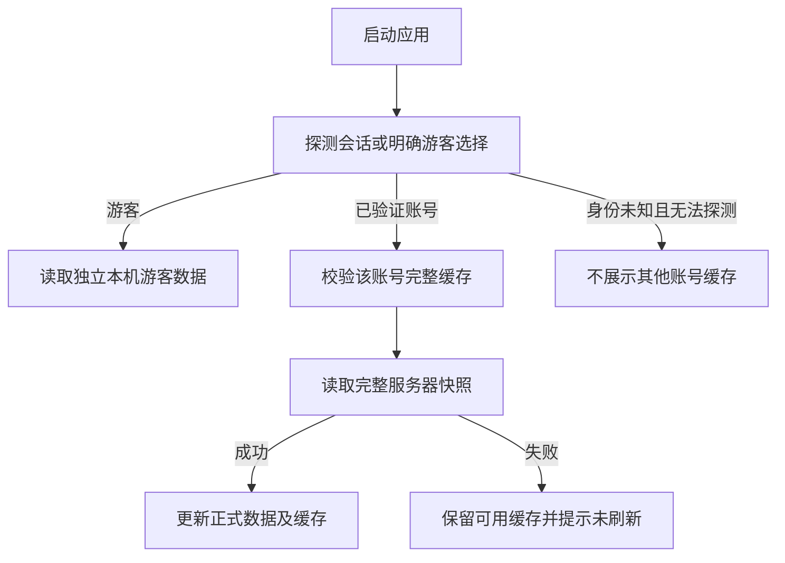

# 日序 Dayline 前端 Spec

| 项目 | 内容 |
| --- | --- |
| 版本 | v0.1 |
| 日期 | 2026-10-26 |
| 状态 | 前端实现规格草案；业务范围按已确认需求，尺寸、参数和库适配属于工程默认 |
| 需求基线 | [requirements.md](requirements.md) v1.0 |
| 接口基线 | [backend-spec.md](backend-spec.md) v0.1 |
| 网页 | Vue 3、TypeScript、Vite，面向电脑浏览器 |
| 小程序 | uni-app、Vue 3、TypeScript，首版发布微信小程序 |
| 当前交付 | 双端完整业务、游客本机事务、搜索统计与四尺度时间轴已实现并有本机自动化及 Chromium 证据；账号完整缓存、持久草稿 / 冲突、生命周期全量刷新与游客接入已落地，Web 文件导入导出与云端 / 游客预览核对已实现；重新验证 / 双向绑定 / 双账号合并及授权来源草稿恢复已实现；注销申请 / 明确撤销与运行收尾已补齐，真机仍待验证，见 [阶段 7 交接](stage7-handoff.md) |

阅读索引：

- [范围与工程](#1-范围与规格效力)、[页面与导航](#3-信息架构与路由)
- [视觉和交互基线](#4-视觉组件与可访问性)
- [数据状态](#5-状态组织与账号边界)、[缓存与游客记录](#6-本机持久化与游客记录)
- [草稿和在线保存](#7-web-草稿与在线保存)、[完整刷新](#8-完整加载轮询与请求协调)
- [事项与重点](#10-事项表单重点和分类)、[完整时间轴](#11-时间轴)
- [登录与扫码](#12-认证扫码与会话)、[绑定合并](#13-身份绑定账号合并与游客接入)
- [文件导入导出](#14-网页-csvjson-导入导出)、[回收站注销](#15-回收站与账号注销)
- [平台适配](#16-平台适配与兼容性)、[测试与验收](#18-测试规格与需求映射)

## 1. 范围与规格效力

### 1.1 当前有效方案

- 两个独立前端工程，共用一个业务后端和同一内部用户身份。
- 游客在两端完整使用本机记录功能；登录后接入云端账号。
- 登录账号在线保存，服务器确认才显示已保存；Web 断网只查看已加载缓存、暂存输入草稿，联网后用户手动提交。
- 小程序登录账号不要求正式离线记录或自动补传；本机游客记录不受此限制，但也不承诺断网冷启动。
- 首次完整加载，之后前台约 30 秒全量刷新；恢复前台或网络立即拉取，不自动提交草稿。
- 网页提供 CSV / JSON 导入导出，小程序提供完整时间轴和其他已确认业务能力。
- 北京时间、30 天事项回收站、7 天注销撤销窗口、保留双方数据的账号合并均遵循需求和后端 Spec。

### 1.2 不纳入首版

完整手机网页、PWA 断网冷启动、独立 App、已登录账号的离线队列、实时推送、强制共用跨端页面、多人协作、支付、AI 分析及原站专用迁移。

文档中的页面路径、组件名、布局尺寸、节流间隔和库建议属于工程默认，不能因默认值而改变已确认数据保留和身份验证规则。库能力与真机表现须实际验证；不能把原站源码调研当成已完成浏览器 UI 体验。

### 1.3 前后端分工

| 前端负责 | 后端负责 |
| --- | --- |
| 展示、表单、导航、键盘 / 触控、本机存储、草稿、轮询时机 | 私人数据归属、身份确认、凭据、版本检查、事务和账号状态 |
| 根据服务器时间和共享规则计算状态、跨度、统计、时间轴几何 | 校验日期、业务范围、删除与注销到期、并发和引用关系 |
| 游客本机业务及文件预览，登录后的接入交互 | 已登录导入 / 合并的预览、review、commit 和幂等结果 |
| 网络失败、冲突、会话失效、缓存失败的清晰反馈 | 稳定错误码及可信的成功 / 失败结果 |

前端隐藏按钮不代替服务端权限。前端不能决定哪个 OpenID 代表谁，也不能用文件中的 userId 改变云端归属。

## 2. 工程结构与共享边界

### 2.1 目录建议

```text
apps/web/src/
├── app/                 # 启动、路由、依赖注入、账号生命周期
├── pages/               # 回看、时间轴、设置、文件和认证页
├── components/          # 网页基础组件和业务组件
├── features/            # 编辑、重点、绑定、导入、冲突等交互
├── stores/              # 会话、快照、草稿、视图状态
├── adapters/            # fetch、IndexedDB、文件、时钟、生命周期
└── styles/              # 设计 token、桌面布局

apps/miniapp/src/
├── App.vue
├── pages.json
├── pages/               # 小程序顶层及编辑、确认页
├── components/          # 小程序基础组件和业务组件
├── features/
├── stores/
├── adapters/            # uni.request、平台存储、微信登录、前后台事件
└── styles/

packages/core/            # 纯日期、状态、统计、范围和时间轴计算
packages/contracts/       # DTO、输入 schema、错误码、文件 schema
packages/api-client/      # 传输注入后的端点调用与错误规范化
```

工程默认两端各自使用 Pinia 管理响应式状态；网页使用 Vue Router，小程序使用 pages.json 与平台页面生命周期，不强行在小程序运行网页路由器。

基础 UI 优先小规模组件和平台原生能力，以延续原站风格；不预设必须采用大型后台管理 UI 库。弹窗、表单、表格和日历选型通过可访问性及真机验证后固定。

### 2.2 共享与独立实现

| 可以共享 | 分端实现 |
| --- | --- |
| DTO、纯输入校验、错误码、导入文件 schema | 页面、弹层、日期选择器、图表渲染、导航 |
| 日期序数、状态、跨度、分类统计、重点分组 | 浏览器事件、微信事件、系统返回、键盘 |
| 输入参数到业务 API 的调用与错误规范化 | fetch / uni.request、Cookie / Bearer、文件下载 |
| 时间轴窗口、裁剪和分组规则 | DOM / 小程序视图、滚动与虚拟化 |
| 相同格式的游客数据包及文件编码规则 | IndexedDB、localStorage、小程序持久存储 |

共享包不能引用 window、document、wx、uni、Node 文件系统或服务端认证实例。仅日期计算与数据校验一致，不要求两个前端拥有同一组件树或同一全局 store。

### 2.3 平台接口

阶段 2 补充：普通业务 2xx 必须带经 schema 校验的 ApiMeta（204 / 304 单列无体协议），记录写入显式启用 requireDataVersion，缺失时不接收凭据或报告保存成功；响应保留 dataVersion 和服务器时间；内容版本、单日重点版本及重点移除确认详情可以由 ClientError.details 继续读取，不降级成一段文本。阶段 4 已提供第 6–8 节账号缓存、Web 持久草稿与生命周期全量刷新；小程序账号编辑仅保留当前页面内存，仍没有离线补传。

阶段 1 传输落地：共享 `ApiClient` 仅接收纯 Transport 与实际 decoder，不依赖平台 SDK。`request<T>` 必须同时传入对应 decoder，否则结果为 unknown；`/me`、微信登录、QR 和原生邮箱关键返回均运行 contracts schema 校验，校验失败不接收刷新凭据。匿名错误密码 401 不清除已有账号，私人会话 401 / 预期账号冲突才失效当前上下文，迟到响应不更新凭据。小程序原生 PATCH 使用后端明确支持的 POST + `X-Dayline-Method-Override: PATCH`。

```ts
interface Transport {
  request<T>(input: RequestInput): Promise<ApiResult<T>>;
}

interface LocalRepository {
  readGuest(): Promise<GuestEnvelope | null>;
  commitGuest(next: GuestEnvelope): Promise<void>;
  readAccountSnapshot(userId: string): Promise<SnapshotEnvelope | null>;
  replaceAccountSnapshot(userId: string, next: SnapshotEnvelope): Promise<void>;
  readDrafts(userId: string): Promise<EntryDraft[]>;
  putDraft(draft: EntryDraft): Promise<void>;
  removeDraft(userId: string, draftId: string): Promise<void>;
}
```

这些是工程边界示意，类型最终在实现中补全；不得把示意的泛型当作已经执行过响应校验。平台接口的失败必须被调用者处理，不能捕获后返回一个空数据集。

## 3. 信息架构与路由

### 3.1 顶层导航

2026-10-27 Web 视觉更新依据用户原站发布版本 9 的截图、HTML、图标及样式文件实现；业务仍连接现有共享规则、Web 本机存储及自托管 API。组件自动化覆盖导航、月历、弹窗保存、重点、分类及时间轴联动；本轮环境没有浏览器控制工具，尚未完成新界面的逐像素截图对照，不能将历史 Chromium 证据视作本次视觉验收。

网页默认进入每日回看，主导航仅保留每日回看和时间轴。Web 视觉以原日序站点发布版本 9 为基准，恢复原站品牌、月历、分类侧栏、周日期条、三张统计卡、事项卡、分类分布、编辑弹窗及时间轴。分类管理从侧栏进入；设置、草稿、回收站和导入导出从右上角账号菜单进入。删除独立的全部记录页，旧链接重定向到每日回看并保留日期 query。

小程序工程默认四个主入口：回看、全部记录、时间轴、我的。分类、回收站及设置从“我的”进入；事项新建按钮在前三个业务页持续可达，不依赖用户先登录。

### 3.2 网页路径

| 路径 | 页面 / 状态 |
| --- | --- |
| `/` | 转到 `/day`，保持用户明确提供的有效回跳参数 |
| `/day?date=YYYY-MM-DD` | 每日回看 |
| `/entries` | 兼容旧链接，重定向到 `/day` 并保留 query |
| `/timeline` | 月 / 季度 / 年 / 全部时间轴 |
| `/entries/new` | 新建事项 |
| `/entries/:id` | 事项详情 / 编辑，保留来源视图 |
| `/categories` | 分类管理 |
| `/trash` | 回收站 |
| `/settings` | 账号、登录方式、数据管理和注销 |
| `/data` | CSV / JSON 导入导出与任务预览 |
| `/drafts` | 当前已验证账号的本机草稿列表 |
| `/auth/login` | 邮箱密码或微信小程序扫码登录 |
| `/auth/register` | 邮箱注册 |
| `/auth/verify-email` | 验证提示 / 回调结果 |
| `/auth/forgot-password` | 申请密码重置 |
| `/auth/reset-password` | 验证链接与设置新密码 |
| `/auth/email-binding` | 邮箱绑定邮件验证结果及继续处理 |
| `/identity` | 重新验证、登录方式绑定及已授权合并任务预览 / 恢复 |
| `/account-deletion` | 注销状态与撤销 |

路由中的记录 ID、任务 ID 不构成权限。returnTo 只允许本站白名单相对路径，不允许跳到任意外部地址。日期、分类 ID、状态和排序可保存为安全 query；搜索词默认保留在当前视图状态，不把私人标题、会话或验证 token 写入常规分享链接。

### 3.3 小程序页面

| 页面 | 用途 |
| --- | --- |
| `pages/day/index` | 每日回看，tab 页 |
| `pages/entries/index` | 全部记录，tab 页 |
| `pages/timeline/index` | 完整时间轴，tab 页 |
| `pages/me/index` | 账号与设置，tab 页 |
| `pages/entry/edit` | 事项编辑 / 新建 |
| `pages/categories/index` | 分类管理 |
| `pages/trash/index` | 回收站 |
| `pages/auth/login` | 微信基础登录和继续游客使用 |
| `pages/auth/scan` | 解析 scene、显示网页登录 / 绑定意图、确认或取消 |
| `pages/account/identity` | 添加邮箱、重新验证、微信绑定、已授权合并概要及任务恢复；邮件验证后主动回来继续 |
| `pages/account/deletion` | 注销申请、状态和撤销 |

小程序码的真实 scan 页面路径必须与后端配置一致。进入扫码页时先解析意图，不先调用普通微信登录为未知身份创建空账号。

### 3.4 导航与未保存内容

- 网页关闭 / 切页前先完成已触发的本机草稿保存；不要依赖 beforeunload 中异步存储一定完成。
- 网页有尚未持久化输入时显示离开确认；浏览器允许时使用原生离开提示，不阻止正常复制内容。
- 小程序有尚未保存的编辑内容时，页面内返回按钮提示继续编辑 / 放弃；系统返回拦截和页面关闭行为以平台实际支持为准，不承诺进程被杀后保留登录账号输入。
- 从详情返回列表 / 时间轴时恢复筛选、日期、滚动位置；不能每次保存都跳回今天或清空筛选。
- 弹层关闭恢复触发控件焦点；详情深链刷新可以独立读取，不要求列表页必须仍在内存。

## 4. 视觉、组件与可访问性

### 4.1 原站视觉基线

以原站第 9 版源码的浅色、低饱和紫色、白色面板、柔和边框和分类色为参考。下表来自源码或其规范化值；需要更高可读性时允许调整辅助文字对比度，不机械复刻过浅文本。

| token | 颜色 / 建议 |
| --- | --- |
| 页面背景 | `#F7F8FC` |
| 面板背景 | `#FFFFFF` |
| 主要文字 | `#303340` |
| 品牌紫 | `#7970CF` |
| 浅紫背景 | `#F0EEFB` |
| 原站辅助文字 | `#9295A5`，实际文本按对比度校正 |
| 原站边框 | `#EEF0F5` |
| 游戏 | `#8B80D8` |
| 阅读 | `#6C9BCE` |
| 工作 | `#D6A063` |
| 运动 | `#6CA58A` |
| 生活 | `#B88EAA` |
| 其他 | `#A0A4B3` |

字体优先系统中文字体和无衬线回退，原站 Inter 仅作为可选本地资源，不依赖境外在线字体服务。首版只承诺浅色主题，不扩展到未确认的暗色主题。

### 4.2 桌面布局

工程默认网页主要验证 1280×720、1440×900、1920×1080；窄于 1024 CSS px 时折叠侧栏并保留基本访问，不将完整手机网页列为首版验收。

- 侧栏建议 232 px；顶部账号与保存状态常驻。
- 内容左右留白建议 24–42 px，主要内容宽度可按页面调整，时间轴优先使用可用宽度。
- 主要按钮高度建议至少 40 px；正文默认 14–16 px，重要提示不使用极小字体。
- 编辑可使用右侧面板或路由弹层，窄屏退化为完整编辑页；实现必须保持深链和历史返回一致。

### 4.3 小程序布局

- 主要验证约 320–430 CSS px 宽度及不同安全区；布局使用 rpx / 弹性单位，图表几何单独用实际 CSS px。
- 内容边距建议 16 px，主要触控目标至少约 44×44 CSS px。
- 底部按钮避让安全区、系统导航和键盘；不让输入法覆盖保存及当前错误。
- 日期、筛选和时间轴控制可分行，不能把电脑工具栏整体缩小。
- 滑动手势与点击操作明确区分，结束一次拖动不能误触删除或打开编辑。

### 4.4 最小组件集

| 通用角色 | 网页 | 小程序 |
| --- | --- | --- |
| `SaveStatus` | 顶栏文字及状态入口 | 顶部 / 我的页简洁状态 |
| `EntryCard / EntryRow` | 卡片、列表行 | 触控卡片 |
| `EntryEditor` | 路由面板 / 弹层 | 独立页面 |
| `DateNavigator` | 日历、前后一天、周条 | 日期选择、周条、前后一天 |
| `CategoryPicker` | 色点下拉及管理入口 | picker / 底部选择层 |
| `FocusButton` | 带日期语义的按钮 | 足够触控区的重点按钮 |
| `ConfirmDialog` | 焦点管理、键盘操作 | 确认层，明确主次按钮 |
| `ConflictReview` | 字段差异、服务器与草稿 | 竖向差异、显式选择 |
| `Timeline` | DOM 网格与按需行渲染 | scroll-view 与分区视图 |
| `ImportReview` | 文件 / 行级差异和分类映射 | 仅游客接入 / 账号合并需要的预览，不增加文件管理 |

### 4.5 可访问性与文案

网页按钮和表单有语义标签；弹窗可通过键盘操作、Escape 按约定关闭、Tab 不逃出模态层，关闭后恢复焦点。错误关联到对应字段，保存状态可被辅助技术识别，但定时刷新不反复播报整页。

不只依赖颜色表示分类、重点、状态和危险操作；提供名称、图标或文字。图表有等价的事项日期与重点列表，不能只有鼠标悬停才读到完整内容。

产品文案使用“已保存到云端”“已暂存本机，尚未提交”“游客 · 仅本机保存”等可理解文字，不显示数据库版本、ETag、内部邮箱、OpenID、事务或技术错误堆栈。复制 requestId 可放在错误详情中，不能替代正常错误提示。

## 5. 状态组织与账号边界

### 5.1 不混为一个状态变量

| 状态域 | 内容 |
| --- | --- |
| `auth` | unknown / guest / authenticated / sessionExpired / pendingDeletion；可信用户 ID、凭据适配、账号代次 |
| `snapshot` | uninitialized / loading / ready / stale / error；完整服务器数据、版本与校验信息 |
| `localStorageHealth` | available / degraded / unavailable；缓存与草稿写入结果 |
| `editor` | 输入、基准记录、dirty、当前请求和冲突 |
| `drafts` | Web 已持久的未提交输入，始终有原账号或游客归属 |
| `guest` | 独立数据集、包修订和本机已保存业务数据 |
| `storageMode` | 当前展示游客空间或账号空间，与是否仍持有有效会话分开，切换不隐式搬数据 |
| `view` | 选定日期、筛选、排序、时间轴尺度和滚动锚点 |
| `operations` | 扫码、导入、合并、注销的有限交互状态与原操作 ID |

例如云端保存已成功但本机缓存写满时，保存状态为成功、缓存状态为失败；不能把整个系统统一设成“保存失败”，也不能因此自动重试创建同一事项。

### 5.2 来源与呈现

登录页面的正式列表只来源于服务器已确认快照 / 已确认写响应；草稿不混进事项总数、重点统计、时间轴或云端导出。可在草稿入口显示数量，但不能伪装成已有事项。

游客页面的正式列表来源于本机持久化成功的游客数据。两种模式使用相同纯业务计算，但保存路径不同，不能把游客本机版本当作云端版本。

### 5.3 Actor 代次

每次登录、退出、用户切换或确认会话失效时增加客户端 `actorGeneration`。请求派发时捕获用户 ID 与代次，返回后先检查仍匹配，再更新任何 store 或缓存。

取消旧请求是优化，代次检查才是必要防线：即使 abort 没生效，A 的响应也不能出现在 B 的页面。下载、认证回调、导入结果和延迟本机写入同样执行该检查。

对已知用户上下文的业务请求携带 `X-Dayline-Expected-User`；它只供服务端比较是否与会话一致，不授予权限。写请求必须提供，启动探测 `/me` 与明确匿名的注册、登录、链接验证 / 重置请求例外；已登录的改密码、退出、重新验证等请求仍须通过适配器带上上下文。发生 `ACTOR_CONTEXT_MISMATCH` 时先停止请求、保留原归属草稿并重新读取 `/me`，不能把输入改挂到实际登录的另一账号。

此补充用于处理同一浏览器另一标签页改变 Cookie 的情况；后端仍以可信会话授权，绝不把这个 header 当成可以自行选择的 userId。

### 5.4 账号切换与退出

离开 A 前停止轮询，记录或提示 A 的未提交输入，处理仍在执行的保存结果，再清除可见 A 状态。进入 B 后只挂载 B 的缓存和数据，A 草稿留在 A 命名空间，不能作为 B 的“待提交记录”。

显式退出成功后清除内存中的私人快照、文件预览和凭据，页面进入游客模式；游客原始数据不被清空。保留在设备上的账号草稿只可在重新验证该账号后显示，不在游客页暴露。

网页可用 BroadcastChannel / storage 事件通知其他标签页“账号可能变化”，只发送最小事件，不广播 token、标题或完整记录；收到事件后重新探测身份，不相信事件自报的用户就直接切换权限。

## 6. 本机持久化与游客记录

### 6.1 命名空间

本机键包含应用 / 环境、存储 schema 和数据空间，例如：

```text
dayline:<environment>:v1:guest:<guestDatasetId>
dayline:<environment>:v1:account:<userId>:snapshot
dayline:<environment>:v1:account:<userId>:draft:<draftId>
dayline:<environment>:v1:account:<userId>:operation:<operationId>
```

不按邮箱、昵称、OpenID 或当前设备 ID 定义云端用户。生产、开发和预览环境隔离；退出不调用全局 clearStorage 清掉整个应用甚至其他 SDK 的数据。

游客当前数据集 ID 存在独立的根 manifest / 元数据中，确保再次打开能找到同一数据集。指针损坏时进入恢复流程，不直接创建新空包并覆盖仍存在的分片。

Web 工程默认完整数据、游客记录与草稿都可放在同一 IndexedDB 的独立对象仓库；少量草稿可使用 localStorage 适配。不要仅为“少一个库”把无限历史塞进同步 localStorage。可使用 Dexie 简化 IndexedDB，但不能被 miniapp 共享包间接引入。

### 6.2 存储信封

```json
{
  "localSchemaVersion": 1,
  "scope": "account",
  "userId": "3ec27828-c254-4f29-853a-a9db80299795",
  "snapshotSchemaVersion": 1,
  "dataVersion": "42",
  "complete": true,
  "savedAt": "2026-10-26T08:00:00.000Z",
  "payload": {
    "categories": [],
    "entries": [],
    "trashEntries": [],
    "focusDays": []
  }
}
```

实际账号信封还需保留 ETag、业务日期等读取信息。读取时验证 schema、账号归属、完整标记、引用关系和结构；解析失败不是“本机本来就没有记录”。

- 真正没有记录：正常初始化游客空间或请求服务器。
- 已有记录损坏 / 不兼容：提示无法读取，保留原始内容，停止会覆盖它的本机写入；可提供原始内容下载 / 复制辅助恢复。
- 存储不可用：明确告知本机保存和草稿暂存不可用，不显示“已暂存”。
- schema 迁移先验证并保留旧副本，成功后切换；不能遇到新 schema 就静默清空。

### 6.3 写入成功条件

Web 使用 IndexedDB 事务原子提交游客业务改动和包修订，事务完成才更新正式本机成功状态。账号缓存写入与草稿写入分开，缓存失败不能删除草稿。

小程序平台键值存储不假定具备跨键事务：小数据可单键提交；超出单键容量时按受控分片及 manifest 提交，先写完并验证新一代分片，最后切换已提交 manifest。失败仍保留上一代完整数据，启动时识别未提交分片并恢复，不能凭最新时间戳选半份数据。

单键限制、总容量、读写中断和 manifest 提交的实际行为需真机验证，不能只在开发者工具验证。完整游客数据、账号缓存和凭据不共用一个巨型键。

### 6.4 游客状态与操作

首次游客使用创建本机 `guestDatasetId`、空事项集合和六个默认分类。分类实例使用 UUID，seed key 和颜色与后端一致，不以 `game` 等语义值充当全局云端 ID。

游客新增、编辑、重点、分类、回收站和导入均执行本机校验与持久提交；成功后增加 `packageRevision`。本机版本用于当地操作与文件更新，不授予云端覆盖权限。

本机回收站删除期限按本机保存时间计算 30 天，应用启动 / 回前台和相关操作时清理；运行环境不活跃时不保证有后台计时器，但到期项不可再显示为可恢复。无回收站外的整份数据自动清理行为。

游客模式不弹出强制登录墙，不在每次写入时请求云端 API。账号入口持续说明“仅保存在此设备，登录后可同步”，保持简洁，不把未登录数据说成已经备份。

### 6.5 本机数据与导入确认

登录接入时冻结本机包：`guestDatasetId + packageRevision + clientOperationId`。后端确认 committed 才标记该版本已经接入；请求失败、响应丢失或用户取消时保留原包。

两端使用纯共享 AdmissionCoordinator 编排显式准备 / 查询 / review / commit，平台提供本机仓库、UUID 与响应式适配；它不是后台上传队列。游客有新修订时先恢复原 pending 冻结包，过期 / 取消 / 服务器任务缺失时可明确重新预览当前本机修订，原操作输入不改变。

拿到服务器任务 ID 以前，保留可恢复的冻结版本，不能只留操作 ID 却用后来改过的包重试。若原冻结版本已经不可用，停止复用该操作标识，先确认既有任务结果或让用户重新准备接入，不能假装相同输入。

确认期间新产生的游客修改属于新修订，旧确认不能将其清空或标成全部已导入。首次导入成功不强制立即删除原始游客包；后续是否清理需要明确本机操作，不能暗中与账号缓存混在一起。

### 6.6 凭据独立存储

网页登录凭据由 HttpOnly Cookie 管理，不复制到 localStorage、Pinia 持久快照、草稿或导出文件。

小程序 Bearer 由专用凭据适配器保存，仅网络层读取；退出时清除凭据，缓存 / 游客数据按各自规则处理。对凭据失效与本机数据丢失分别处理，不能清掉登录 token 就认为记录已经删除。

## 7. Web 草稿与在线保存

### 7.1 范围

登录账号的事项表单输入可在 Web 暂存草稿，包括新建和编辑。草稿只是未提交输入，不是已保存记录。离线时的重点按钮、删除、结束、分类写入和回收站操作不排队：明确需要联网，保留已有页面内容。

小程序登录账号保留当前页面的内存输入用于重试，不要求跨关闭 / 杀进程的持久草稿或离线记录队列。游客完整本机功能仍可使用；平台能力不能成为混淆两类保存结果的理由。

`LocalRepository` 的草稿接口仅由 Web 实现；工程中可拆成独立 DraftRepository，并通过能力标记避免小程序误调用后端草稿或浏览器 API。

### 7.2 草稿结构

```json
{
  "localSchemaVersion": 1,
  "draftId": "debe7589-370b-42f2-a303-002db4b5077a",
  "scope": "account",
  "userId": "3ec27828-c254-4f29-853a-a9db80299795",
  "kind": "edit",
  "entryId": "16e31354-ac7d-4d68-898c-eae9ec28bb5e",
  "baseEntryVersion": 3,
  "inputRevision": 7,
  "persistedRevision": 7,
  "fields": {
    "title": "阅读三体",
    "startDate": "2026-10-01",
    "endDate": "2026-10-26",
    "categoryId": "6d63aa57-48c7-4bb9-bd3f-1914bb35558c"
  },
  "savedLocallyAt": "2026-10-26T08:00:00.000Z"
}
```

实际保存还可包含用于差异展示的基准字段快照，不能含密码、邮箱验证 token 或 Bearer。新建草稿的 `entryId` 在首次创建时固定，`baseEntryVersion=null`，同次保存重试不换 ID。

### 7.3 草稿暂存

工程默认输入停止约 300 毫秒后尝试本机保存，失焦和应用内离开前主动 flush。只有对应 `inputRevision` 写入成功后才显示“已暂存本机”。自动暂存仅写本机，不自动调用业务保存接口。

用户每次输入增加 `inputRevision`，过时的存储完成回调不能把新输入标成已经持久。多个编辑标签的草稿使用不同 draftId，必要时显示同一事项有其他本机草稿，不能最后写入一份就把另一份覆盖。

关闭前仍未写入成功时尽力提示并允许复制输入；不能承诺浏览器突然结束、隐私模式清理或系统删缓存后找回草稿。已知存储失败时显示持续可见的错误，不能仅闪一个短 Toast。

### 7.4 保存状态机

```text
clean -> editing -> saving -> saved
               |      |
               |      +--> conflict / authRequired / saveUncertain / failed
               +--> draftPersisting -> draftStored / localWriteFailed
```

草稿持久状态与网络保存状态可同时存在，不必强行压成线性单状态。保存按钮在请求期间防止重复点击，但可保留用户继续输入的能力。

### 7.5 手动保存流程

1. 读取当前可信账号、原始基准版本和表单，做共享校验。
2. 记录当前 inputRevision 和本次请求快照，带稳定 ID / expectedVersion 及预期账号上下文发起请求。
3. 服务器成功提交后，更新正式记录与已知数据版本，再写账号缓存。
4. 当前输入仍等于该请求版本时，清理该草稿并显示“已保存到云端”。
5. 请求期间又有输入时，保留新草稿，不清空编辑框；可将本次已确认响应作为新输入的可信基准，显示“已保存，仍有未提交修改”。
6. 后续 GET 刷新不能像自己的保存确认一样更新草稿基准。

缓存写入失败但云端成功时显示“已保存到云端，本机缓存更新失败”，不重新发送创建请求。

### 7.6 网络中断与响应不明

- 已知离线：表单可继续输入及暂存，保存按钮说明“联网后保存”；不生成待上传任务。
- 请求超时 / 响应丢失：保留输入，标记“保存结果待确认”，先 GET 当前事项 / 原任务核对，不直接断言服务器一定没保存。
- 新建相同 ID 的重试只有用户再点击保存才发起；服务端 alreadyExists 结果需核对，不能把不同内容当作本次保存成功。
- 重新联网：刷新数据并提示草稿尚未提交，不自动点击保存，不自动用最新版本替换草稿基准。
- 会话过期：保存草稿归属，重新验证同一账号、加载最新内容后，再由用户手动保存。

### 7.7 版本冲突界面

显示服务器当前字段、草稿输入和具体差异；默认不选择覆盖，提供：

- 使用服务器内容：明确放弃该草稿修改后更新表单。
- 核对后保存我的修改：展示新的基准，用户确认后再发版本受控请求。
- 另存一份：显式生成新 UUID，不覆盖原事项。
- 暂不处理：保留草稿，继续只读或返回。

原事项已删除时显示回收站状态；恢复走独立恢复接口，不能把 PATCH 失败退化为创建。已永久清理时只可由用户明确选择新建副本。后台自动三方合并不作为首版功能。

### 7.8 草稿列表

仅在重新验证所属账号后展示标题摘要、最后暂存时间、新建 / 编辑及冲突状态，入口可在保存状态和设置中提供。支持继续编辑、复制 / 下载单份输入、明确放弃；放弃草稿不删除服务器事项。

草稿不会进入普通 CSV / JSON 云端备份；导出前提示“有未提交草稿”，允许先手动保存或继续只导出云端记录。不因导出或退出而暗中提交。

## 8. 完整加载、轮询与请求协调

### 8.1 启动顺序



身份未确认时不能拿最近一次缓存的邮箱直接“恢复登录”。首次无缓存显示加载 / 重试，不显示“还没有记录”或初始化云端默认分类。

用户明确选择游客空间时，不因探测到 Cookie 就自动导入或覆盖本机数据；进入账号记录及游客接入应有清晰的用户动作。账号会话存在与当前展示哪个数据空间分开处理。

已加载页面后来断网可以读现有缓存；这不等于支持断网冷启动。显式继续游客时加载游客空间，不自动将账号缓存复制成游客记录。

### 8.2 快照接受条件

`GET /api/v1/snapshot` 的响应须通过共享 schema 和以下检查：

- 用户 ID 与当前 Actor 一致，代次未变。
- `complete=true`，schemaVersion 支持，分类 / 事项 / 重点引用合法。
- 数据版本在当前已确认在线基线下不倒退；自己的写响应已确认更高版本时，较旧 GET 不覆盖。
- 全部数据读取成功才整体替换正式快照；子集或损坏响应不与旧数据随意拼接为“完整”。

dataVersion 作为十进制字符串，用长度与数字位序比较等经验证方式，不能用普通字典序，也不要求小程序必须支持 BigInt。

重新登录 / 恢复后的首次基线以服务器为准，本机旧版本号不能让用户永远拒绝接收恢复后的数据库；保留草稿再重新核对，不上传高版本缓存覆盖服务器。

### 8.3 ETag 与 304

ETag 和完整缓存绑定账号、schema、数据版本及业务日期。只有本机确实持有可用完整数据时才发送 If-None-Match；缓存丢失后不能拿残留 ETag 请求 304 然后展示空列表。

304 无 JSON 响应体，不调用 JSON 解码；保留现有完整快照，更新合理的最近检查时间。账号变化、cache schema 改变或完整缓存损坏时清理对应验证器，重新获取 200。

### 8.4 调度

- 网页使用 document.visibilityState、focus 和网络事件；focus / visible 同时触发时合并为一次。
- 小程序使用 App / 页面 onShow、onHide 及平台网络状态；切 tab 不建立多套并行定时器。
- 仅当前活跃、已登录且可读取的账号运行约 30 秒刷新；游客没有云端轮询。
- 回前台 / 网络恢复立即安排读取；后台暂停，重新进入时补一次。
- 单个客户端最多一个完整快照请求在途，可登记一次后续刷新需求；不每秒叠加排队任务。
- 失败工程默认 5 / 15 / 30 秒退避，遵守 Retry-After；退避只针对读取，不自动重发业务写入。

### 8.5 与写入协调

写响应带 dataVersion，已有更早的 GET 返回时丢弃或安排新快照。全局快照与局部写结果使用同一协调器，不能由每个页面独立覆盖 store。

重点、分类迁移、删除和恢复确认后更新已知记录，必要时安排完整刷新；保留编辑器输入及原基准。导入、合并完成后必须重新完整读取，不手工拼接大量不确定结果。

用户切换期间停止普通业务请求，发出的请求仍必须带原预期账号；AbortController / uni RequestTask.abort 只优化资源，不替代代次和服务端一致性检查。

### 8.6 时间与今天

优先使用服务器 businessToday、timeZone 和 serverTime 校准界面。页面持续运行时按单调经过时间推进校准时钟，北京时间跨日后更新今天高亮并安排读取；历史选定日不因此跳走。

游客尚未有服务器时间时可用设备时间按 Asia/Shanghai 推导今天，不能用浏览器所在时区默认值。登录提交时仍以服务器校验为准，设备时钟错误不构成忽略日期错误的理由。

日历日期使用纯序数 / 日历运算，禁止以本地午夜毫秒差除以 86400000 来算跨度；年份 0001–0099、闰年和夏令时设备需测试，不把 JavaScript 日期自动纠正当合法输入。

## 9. 回看、全部记录、筛选与统计

### 9.1 每日回看

显示选定日、星期、前后一天、回到今天及日历入口；默认选北京时间今天。按周一到周日显示当前周，日期切换后同步周条和日历，但不强制清空用户选择的分类。

选定日的事项集合按实际日期区间计算：已结束事项包含首尾，未填写结束日期的回顾覆盖到今天。未来日期可以浏览，但不可标记未来重点，未结束事项不能被当成已经在未来发生。

每条事项显示标题、分类、起止或“至今”、跨度、当前状态，以及针对选定日期的重点操作。历史回看不因事项今天已经结束就隐藏；工程默认状态筛选为全部。

日期选择与时间轴定位是不同视图状态，只有用户显式从时间轴进入某日才联动；普通修改事项不让历史回看跳到今天。

### 9.2 全部记录

- 展示全部活动事项，按开始日期升 / 降序，工程默认降序；同日按稳定 ID 排序避免刷新时跳动。
- 标题搜索、分类和状态组合筛选；状态包括全部、未开始、进行中、已结束。
- 搜索只在当前完整数据空间执行，标题按统一的去首尾空白和大小写比较规则处理，不请求 ChatGPT 或远程搜索服务。
- 搜索输入工程默认约 150 毫秒防抖；输入法组合期间不打断中文输入。
- 大量记录按可见行渲染，不把页面当前只渲染 30 行误当成账号只有 30 条。
- 修改后不再符合当前筛选的事项可从列表移出，并用短提示说明；不能显示“保存后丢失”。

### 9.3 筛选范围

列表与时间轴复用同一筛选规则，但可各自保留尺度、滚动和排序。回看先取选定日集合，再应用筛选；全部记录取全部活动记录；时间轴取与当前时间范围相交的活动记录。

日期选择、筛选值和排序可记入当前数据空间的视图偏好，不包含私人搜索词的跨账号自动沿用；分类被删除后移除失效筛选并提示，不返回空列表冒充没有记录。

### 9.4 统计

首版统计包括当前明确范围内的事项数、今天仍在进行的事项数、涉及分类数和按事项数量的分类分布。历史回看标签区分“选定日事项”和“今天仍在进行”，不把今天状态当成历史状态。

每件事在分类分布中计一次，比例分母是当前统计范围事项数，排除回收站、草稿和示例。时间轴统计针对所选整段范围和筛选结果，不随虚拟列表只渲染几行而变化。

无数据时分布显示空态，不显示假的 100% 圆环。图形旁有分类名称和数量，文案明确“按事项数量”，不写成时间投入占比。

### 9.5 空态、示例与失败

| 情况 | 反馈 |
| --- | --- |
| 首次完整加载中 | 骨架 / 加载提示，不显示零条记录结论 |
| 当前空间确实为空 | 简洁介绍和新建入口，可主动查看示例 |
| 当天无事项 | 保留日期导航，提供新建或回今天 |
| 筛选后为空 | 显示筛选条件与清除入口 |
| 有缓存但刷新失败 | 保留缓存并显示上次成功刷新时间和重试 |
| 无缓存且读取失败 | 明确错误和重试，不生成默认云端数据 |

示例属于独立演示集合，不持久化到游客真实空间，不计入导出、游客接入或账号合并；用户退出示例 / 新建自己的记录时不把示例复制成正式事项。

## 10. 事项表单、重点和分类

### 10.1 事项表单

| 字段 | 默认 / 校验 | 交互 |
| --- | --- | --- |
| 标题 | 去首尾空白后 1–100 码点 | 明确标签、字数提示，错误不只用红色 |
| 开始日期 | 新建默认今天，严格日历日期 | 允许未来，保留用户输入而不自动改正无效日期 |
| 结束日期 | 默认空，填写时不早于开始 | 显式“未结束 / 清空”，不以今天自动填空值 |
| 分类 | 选择当前空间有效分类 | 新建可默认上次有效分类或首个分类；失效时要求重选 |

显示从开始到结束 / 今天的跨度，包含首尾；未来事项显示“未开始”，不显示负天数或已经持续。表单上的派生值不作为后端状态字段提交。

工程默认核心编辑只含标题、起止和分类；重点日期从详情 / 回看独立操作，不把一串未保存的重点点击悄悄塞进事项 PATCH。

### 10.2 创建和编辑

打开新建时分配稳定 UUID；页面暂存、失败重试和同一次恢复草稿沿用该 ID。取消后不在正式列表保留空事项；用户明确另存一份才生成新 ID。

打开编辑时复制已确认字段到 editor，并冻结 baseEntryVersion。正式 store 后来更新只提示“服务器有更新”，不覆盖正在输入的字段。

网页保存遵循第 7 节；小程序在线保存时禁用重复提交，错误保持当前内存输入。游客保存则等待本机事务成功，不调用云端事项端点。

### 10.3 缩短范围与重点确认

可在本地先计算影响作为提示，但后端返回的 `FOCUS_REMOVAL_CONFIRMATION_REQUIRED` 是权威依据。展示将移除的具体日期、数量与取消 / 确认按钮。

用户确认后原样携带最新受影响 `{date,version}` 集合为 `focusRemovalAcknowledgement` 再提交。若服务器再次返回变化，刷新确认内容要求再次选择，不沿用旧 confirmed 标记。

游客使用相同提示，在单个本机提交中修改区间和重点；取消时两者都不变。

### 10.4 每日重点

重点按钮必须让用户知道针对哪一天，不是整件事项的永久收藏。只有有效区间内、今天及过去日期可设 true；将来的按钮有禁用说明。

登录操作发送明确 `focused=true/false`、事项内容版本和该日重点版本；未出现过的日期基准为 0，不用事项 focusVersion 代替单日版本。保留服务器返回的 false 状态与版本，显示时只统计 true。

首版默认等待成功再变成正式重点；请求期间可显示轻量 pending 标记，不能让图标、计数和“已保存”提前一致声称成功。不同日期允许各自提交，同一天防止重复点击和旧响应覆盖。

断网登录态不把重点操作排入队列；游客在本机持久成功后更新图标。详情提供重点日期列表，时间轴周 / 月汇总可点开具体日期。

### 10.5 结束与删除

结束按钮明确“今天结束”，仅适用今天已经开始且尚未结束的事项；未来事项提示修改日期。后端返回已经结束时刷新已有结束日期，不默认延长历史事项。

删除先确认移入 30 天回收站，说明重点一起进入。未收到成功响应前不永久移除；可显示进行中状态，失败恢复可操作界面。请求超时先查结果，不能因重复点击延长回收站期限。

### 10.6 分类管理

展示名称、色点和使用事项数，可新建、改名、改色及删除；颜色值校验为 `#RRGGBB`，输入 / 展示规范化，后端规则仍为最终依据。

- 名称 1–12 码点、同空间不可重名，工程默认最多 20 个、至少保留 1 个。
- 删除需选择另一个分类接收正常与回收站事项，展示影响数量，不能让“删除分类”同时删除经历。
- 提交来源及目标分类版本；并发变化返回后重新展示，不自动找一个新目标替用户决定。
- 成功后更新分类映射和相关事项，保留有效筛选与编辑输入；被删除分类仍被草稿引用时提示重选。
- 小程序使用独立表单 / 选择层，不把桌面多列表格挤在窄屏。

## 11. 时间轴

### 11.1 双端完整能力

两端均提供月、季度、年、全部时间，前后范围切换、定位今天、分类 / 状态 / 标题筛选、开始日期排序和重点日期展示。小程序首版不是只有简化列表。

首版时间轴用于浏览和进入详情，不提供拖拽改日期、拖拽伸缩跨度或直接在格子批量写入，避免增加未确认的编辑语义。

### 11.2 共享几何契约

纯计算函数接收事项集合、businessToday、尺度、锚点、可用宽度和平台密度参数，输出范围、刻度、分组、横条裁剪及重点分组；不直接访问 DOM 或 uni。

- 所有窗口按半开区间 `[rangeStart, rangeEndExclusive)`，事项起止显示仍包含首尾。
- 横条左位置按开始日期相对窗口的日期序数差计算，宽度使用包含首尾的天数。
- 未结束事项绘制到今天；未来才开始且未填结束日期时至少显示开始日标记并标为未开始，不画负宽度。
- 超出窗口的横条裁剪并有延续提示；不把裁剪后的左右端点当成真实起止日期。
- 所有状态和刻度采用北京时间日历规则，与后端日期校验保持一致。

### 11.3 尺度

| 尺度 | 窗口 | 工程默认密度 |
| --- | --- | --- |
| 月 | 锚点所在自然月 | 网页约 34 px / 日，小程序约 28 px / 日 |
| 季度 | 锚点所在自然季度 | 网页约 12 px / 日，小程序约 10 px / 日 |
| 年 | 锚点所在自然年 | 约 4 px / 日，重点按月汇总 |
| 全部时间 | 当前筛选结果最早开始月到最晚结束 / 今天所在月 | 根据可用宽度适配，过长区间使用稀疏刻度 |

这些是显示参数，不改变业务日期。全部时间无数据时回退当前月；全部时间下禁用无意义的前后范围按钮。其他尺度的前后移动分别按月、季度、年，不按固定 30 / 90 / 365 天推算。

“定位今天”把锚点设为今天并使今天进入可视区；若全部时间范围不包含今天，工程默认切回今天所在月，而不是在范围外滚到负位置。尺度切换尽量保留所浏览日期作为锚点，不能每次都无条件回当前月。

### 11.4 网页布局

- 固定事项名称列，日期区横向滚动；标题行在纵向浏览时可见。
- 名称列建议 200–240 px，行高建议 48 px，长标题省略但可通过键盘 / 点击读完整内容。
- 横条和重点区域都有可访问名称，包括标题、实际日期和状态；点击进入详情 / 重点列表后能恢复原滚动位置。
- 可使用 CSS Grid / 绝对定位计算横条，虚拟化纵向事项行；首版不强制 canvas 或图表 SaaS。
- 不拦截普通页面滚轮造成滚动陷阱；提供可识别的水平滚动区及定位今天按钮。

### 11.5 小程序布局与滚动

工程默认采用平台视图与 scroll-view，先验证以下结构：

1. 控制区独立分行，名称标题和日期轴保持可识别。
2. 外层纵向滚动体中，名称列与日期行共享同一个垂直滚动位置。
3. 日期绘图区独立横向滚动，名称列在水平滚动之外。
4. 日期头和绘图区共享 scrollLeft；事件带来源并比较差值，避免相互同步形成回调循环。
5. 名称行和图形行使用固定且相同的测量高度，虚拟列表共用起止索引和上下占位。

名称宽建议 96–120 CSS px、行高约 52 CSS px，允许双行截断。图表几何用实际 CSS px，不能一边用 rpx 一边用 px 导致横条、表头或名称错位。

横向与纵向嵌套手势、低版本滚动和页面滚动穿透必须真机测试；如原生视图性能不满足，再评估绘制适配，不把未验证的 DOM sticky 或浏览器 canvas 库直接搬进小程序。

### 11.6 重点分组与点击

月视图优先按日展示，季度按周，年按月；全部时间按跨度选择日 / 周 / 月，周从周一开始。分组数量必须是真实重点日期数，false 状态和回收站事项不计入。

密集标记提供可点击的日期列表 / 汇总弹层，触控区扩大不能改变日期含义；重叠触控区不随机选一天。选择具体日期后可以进入对应回看并保留返回时间轴的上下文。

### 11.7 大数据和极长区间

完整缓存不等于完整渲染。工程默认可见行加上下各约 10 行 overscan，长范围刻度预算约 80 个，月 / 年分组按范围自适应；横条按一条事项一个 / 少量元素计算，不生成每事项 × 每一天的海量格子。

几百年区间也不逐日循环生成 DOM / 小程序节点；年份 0001–9999 的数据必须通过有界刻度计算或明确的范围展示策略处理，不能卡死。极小横条可提供最小可点视觉标记，详情仍展示真实跨度。

筛选变化导致全部时间窗口变化时重新计算并合理恢复锚点；不恢复一个超过当前内容宽度的旧 scrollLeft。排序变更可保留当前首个可见事项作为锚点，不在后台刷新后不断跳顶。

### 11.8 性能目标的验证方式

按需求建议的 1,000 条事项 / 10,000 条重点测试网页和真实小程序设备，记录首次计算、渲染、滚动、节点量和主线程 / 逻辑层耗时。目标是常规交互无明显持续卡顿，具体预算在 Gate-F 中实测固定，不把浏览器模拟器帧率当成真机结论。

## 12. 认证、扫码与会话

### 12.1 网页邮箱流程

2026-10-28 视觉调整：使用纸白 `#f6f7f4`、白色 `#ffffff`、墨灰 `#26352d`、次要文字 `#637268`、青绿 `#315c4d` 和边线 `#dfe5de` 六个基础色，集中为 CSS tokens；中文系统字体，不新增远程字体请求。注册 / 登录标题分别明确标识当前状态，选中切换按钮填充主色并加粗，未选中保持透明；通用表单按钮规则不能覆盖切换按钮。

头像菜单在鼠标进入入口或弹层时打开，离开两者后关闭，保留短暂过渡以便跨过弹层间隙；触屏点击、键盘焦点和 Escape 仍可使用。菜单标题和操作区域之间有独立间距与分隔线，不依赖链接本身的 padding 撑开。

| 页面 | 输入 / 结果 | 要求 |
| --- | --- | --- |
| 登录 | 邮箱、密码，另有微信扫码入口 | 不用邮箱文字猜账号是否同一人 |
| 注册 | 显示名、邮箱、密码及确认 | 与后端 1–40 码点显示名、8–128 密码规则一致 |
| 待验证 | 邮箱说明、重发按钮、返回登录 | 限流倒计时依服务器返回，不说“已送达” |
| 验证结果 | 成功、失效、已使用、暂不可用 | 根据真实接口结果 / 重新探测会话，不相信 URL 的 success 字样 |
| 忘记密码 | 邮箱、通用提交结果 | 不显示该邮箱是否注册 |
| 重置密码 | 链接凭据、新密码和确认 | 过期重新申请，成功后按策略重新登录 |

标准邮箱端点使用 Better Auth 原生协议，认证适配器与业务 ApiResult 分开解析。网页 SDK 负责合法的 Cookie 交互，不复制 Bearer 到本机缓存。

游客菜单合并为单个“登录·注册”入口，默认进入 `/login`；登录与注册使用同一组件内的切换按钮，旧 `/register`、`/auth/login`、`/auth/register` 深链继续可用。切换清除密码输入，保留邮箱，不能仅输入陌生邮箱就自动注册。

注册提交按 emailFlow 导航：新建 / 已有未验证账号自动进入 `/verify` 并带入邮箱；已验证账号进入登录页，提示使用原密码或找回。验证页明确展示邮件已受理、发送失败或结果未确认，已有待验证账号显示原密码未修改；失败也可直接重发，不要求重填注册表单。登录得到 EMAIL_NOT_VERIFIED 时进入相同验证页，发送由用户明确触发。

验证邮件的 callbackURL 指向 `/login` 并携带非凭据的邮箱提示，后端验证链接后返回登录页；提示仅用于填表，解析后从当前地址栏移除，不作为身份或已验证证明，因此邮件在新标签页打开也能带入邮箱。原 `/verified` 回调仍兼容并跳到登录，实际验证状态以随后登录接口为准。密码重置成功后也进入登录页。

失效验证链接带可信 callbackURL 时，后端返回该可信来源的 `/verify` 并携带固定失效提示，页面允许直接重发；没有可信回调则保留 API 错误，不能跳转到外部来源。

sessionStorage 仅保存最近提交邮箱、邮件引导和冷却截止时间，不含密码或链接 token。刷新 / 切页恢复真实剩余倒计时，不从完整 60 秒重新计时；邮件冷却不会禁用密码登录，密码登录限流也不会冒充邮件冷却。匿名启动先通过 `/api/v1/auth/session` 正常识别游客，不请求 `/me` 产生预期外 401；已知会话的真正失效继续执行原有私人缓存隔离。

表单使用正确的 autocomplete 属性、密码可见性切换和一致字段错误；密码不进入草稿、持久 store、URL 或日志。不因浏览器自动填充就跳过校验，也不悄悄截短密码。

认证失败在表单上方持续显示中文提示，不只依赖控制台或网络面板。429 响应按 `Retry-After` 显示实时剩余秒数，提交按钮同步显示倒计时并禁用；结束后清除过时的限流错误，提示可手动重试，不自动重发。服务器未提供有效等待时间时只提示稍后重试，不虚构秒数。邮件服务不可用显示邮件发送失败提示，不展示服务商原始错误或宣称已发送成功。

### 12.2 认证回调和链接

验证 / 重置 / 绑定链接的 token 仅存在于处理所需的短期内存和网络请求，适当处理后使用 replaceState 移除敏感 query；不要把原链接附到普通 returnTo、埋点或错误日志。

Better Auth 验证链接可能先到后端再回前端，前端只展示真实结果并读取 `/me`，不能重复消费同一链接或自己设置 emailVerified。验证码 / 链接失效时提供受限重发入口。

认证回调可能改变浏览器会话，必须经过账号转换协调器，使旧请求失效并保留旧账号草稿。验证邮箱不等于把现有 A 和邮箱 B 的数据合并。

虽然完整手机网页不属于首版，邮件验证、重置及绑定结果等必要认证页仍需在常见手机浏览器可读可操作；不要求同时完成全部手机业务布局。

阶段 1 已提供这些邮箱界面。网页回调首次读取 token / error 后移除地址栏敏感 query，同时保留 Router 导航位置 / 滚动元数据，并清理 history state 的 current / back / forward URL 中的敏感 query。`/verified` 路径本身不能证明邮箱已验证，实际登录由服务端检查。

### 12.3 微信小程序登录

游客不被强制登录。用户点击登录后调用平台登录取得新 code，提交 `/api/v1/auth/wechat/login`，成功后保存专用会话凭据并读取 `/me` 和完整快照。

不要求手机号、昵称、头像或必有 UnionID，不在启动时为每个打开应用的游客自动建立云端账号。基础登录不等于这些额外授权都已获得。

已有凭据可按协议恢复；失效时提示重新登录，同次失败不能一直重用失效 code。重新验证若得到另一账号，按真实账号变化处理，不能把旧缓存上传给新账号。

换手机或清除缓存后登录同一微信身份，前端只从服务器重新完整加载，不自行生成新的云端 userId 或发送空数据覆盖。

### 12.4 网页扫码状态

登录页的扫码标题明确“用微信登录”；设置中的二维码标题明确“绑定微信”。创建时目的由受控交互固定，页面切换目的必须取消旧请求并创建新请求，不复用二维码改标签。

```text
creating -> waiting -> scanned -> confirmed -> consuming -> success
    |          |         |            |
    +----------+---------+------------+--> cancelled / expired / error
```

- 显示小程序码、有效期与刷新入口；工程默认每 2 秒查询状态，区别于业务 30 秒轮询。
- 仅扫描显示“已扫描，请在微信中确认”，不能提前跳进账号。
- confirmed 后当前原浏览器可领取；消费请求去重，不因轮询触发多次。
- 到期以服务器为准，用户手动刷新生成新请求；取消、过期或退出页面停止查询。
- 响应不明先探测当前会话；确实未拿到会话则重新扫码，不重放已消费码。
- 若网页当前为 A、登录身份是 B，清楚提示进入 B，保持两份账号独立。

### 12.5 小程序扫码页

解析 scene 后调用后端 resolve，按服务端返回的受验证意图显示“确认登录日序网页”或“确认绑定到账号”。用户明确点确认 / 取消，扫描本身不代表同意。

未知微信从绑定场景进入时，先通过 fresh code 解析请求并等待确认，不先调用普通登录造空账号。确认凭据只留在本次流程内存，不放进可复制链接或本机业务包。确认后、网页消费前仍保留内存 proof 并提供取消入口；消费后取消显示请求已结束，卸载时清理 proof。

请求已过期、目的不匹配或扫码身份冲突时显示明确结果并返回，不尝试本地更改 userId / purpose 绕过。取消不会退出已有独立账号，也不会删除本机数据。

### 12.6 登录后顺序

认证成功 → 校验 `/me` → 判断账号是否待注销 → 处理仍保留的游客接入 → 完整加载 → 进入安全回跳目标。可先显示已有云端概要，但不能在身份未确认时显示另一账号内容。

回跳原游客事项时先检查导入映射；暂不导入或无法映射则回账号回看页，不能用游客 ID 盲目请求同名云端记录。内部占位邮箱一律不显示为绑定邮箱，账号信息以公开 `/me` DTO 为准。

### 12.7 会话失效

停止写入和普通轮询，Web 保留原账号草稿，给出重新登录入口。退出、改密、绑定 / 合并和注销导致的会话变化都走同一协调器。

重新登录相同账号后先拉取新数据，再恢复草稿；登录不同账号时不自动导入旧草稿。不能以“为了恢复保存”之名静默重试写请求。

## 13. 身份绑定、账号合并与游客接入

### 13.1 账号设置入口

展示真实邮箱及验证状态、密码是否启用、微信绑定状态和当前用户显示名。入口使用“添加邮箱”“绑定微信”等明确动作；登录页仍使用“登录”，两者不共用含糊按钮。

首版不承诺无限邮箱 / 微信绑定或任意解绑唯一登录方式；后端返回组合不支持时保留现有账号，不给出可能丢失唯一入口的快捷解绑。

### 13.2 添加邮箱

当前身份重新验证 → 输入邮箱并发送绑定邮件 → 邮件链接验证 → 重新确认原发起账号 → 完成未占用邮箱绑定并设置密码，或进入已存在账号合并。

邮件可在另一设备打开，匿名链接验证页只确认验证结果，不展示账号记录；最终 complete 必须使用原发起账号和有效证明；同 UID / epoch 退出后重新登录，可用新 SID 的 fresh proof 恢复原已验证申请，无需重发，旧 SID proof 不复用。小程序可显示“已发送，完成邮件验证后回来继续”，用户回来后主动继续，服务器在 complete 时检查验证状态；不轮询未定义的接口，也不承诺所有邮件客户端都能直接唤回小程序。

### 13.3 绑定微信

- 未占用微信：确认关联当前账号，成功后按后端要求刷新 / 重新登录，不创造多余空账号。
- 已关联当前账号：显示已绑定，正常完整刷新。
- 微信属于 B：只有双方证明完成后才展示 A / B 概要，进入预览或暂不绑定。
- 同一用户只是两端数量不同：执行完整刷新和草稿检查，不弹“保留哪一份账号数据”。

### 13.4 合并预览

显示两边显示名 / 受验证登录标识概要、活动与回收站事项数、分类和重点数，以及将新增、复用、改名、映射和冲突的数量。

主要选择为“合并并保留双方”及“暂不绑定”，无整份覆盖删除 A / B 的默认按钮。同名事项不会因为标题相同自动合并；分类同名异色的区分、超过 20 个分类及不支持身份组合均清楚展示。

用户选择分类映射或显示名后，立即禁止提交旧计划；调用 review，传 expectedPlanRevision，拿到新 planDigest / planRevision 且 canCommit=true 才能确认。review 失败保留尚未保存的选择，继续禁止提交；review / commit 中锁定可编辑选择。变化导致 PREVIEW_STALE 时展示新的差异，不能旧确认一键继续套用。

### 13.5 执行、取消与恢复

合并必须在线，当前草稿先手动保存或明确保留。确认前按用途重新验证双方，证明过期只重做验证，不丢未过期预览；账号 epoch 变化失去授权则停止展示敏感预览并重建流程。

提交中禁止重复触发，网络结果不明保留操作 ID，通过重新验证后的任务状态查询确认，不再新建合并。成功后重新登录目标账号并完整读取；其他网页的旧草稿通过受授权映射重新关联，核对后手动保存。

暂不绑定 / 取消只结束本次操作，保留 A、B 及本机数据；不将取消误当成账号退出。不存在面向用户的一键撤销已完成合并承诺。

阶段 6 两端分别实现登录方式页：先确认真实账号 / 当前空间和本空间任务恢复就绪才开放操作。Web 微信重新验证使用专用扫码，手机使用 fresh code；密码、proof 和扫码确认凭据只留短期内存。错误重新验证显示本次需重试，不退出有效账号。

绑定 / 合并写入可能撤销当前 session，因此两端暂停新快照及身份 GET，并排空既有 /me 与快照读取；期间 focus / onShow 不发新的身份读取。提交成功先接收持久结果再清身份；失败恢复普通读取，不自动重试写入。会话 / 空间 / 意图变化清全部私有预览、邮箱申请及证明，旧异步成功 / 错误 / finally 不写新状态；仅保留必要最小完成提示。同 UID 的普通 /me 刷新不属于身份切换，保留当前证明、预览和已授权来源草稿。Web 切目的先取消旧码，包括迟到创建结果，不能只停轮询。

任务用时间及状态显示，不让用户用 UUID 辨认或手填任务。预览中双方事项与重点详情每页 50，重点包含 false 和原回收站期限；分类显示来源名色及拟映射 / 新名色，提交前可改名 / 映射和选择显示名。五分钟授权到期可在同操作重新验证双方，恢复十五分钟有效的原核对计划。

Web 邮件结果页与绑定表单分开，初始化时清 URL 及 history current / back / forward 中的 token。草稿页先选已完成合并，再为 recover_drafts 重新验证并从后端取 mapping；只有授权完成才读本机来源仓库。每次 await 后复核 actor / 空间 / 选中合并 / 操作；切选择清旧提示及分类。复制新分支保留原稿和可靠原始基准，缺少基准或映射需手动重审 / 另存，不自动 POST。原导入任务仍不可被目标直接读取私密计划。

### 13.6 游客登录接入

登录前说明“本机记录会按账号情况接入”；登录成功后冻结当前游客包并保持原始副本，调用 guest-admissions/prepare。

| 服务端结果 | 前端行为 |
| --- | --- |
| `committed` | 云端原为空且接入完成，标记该包修订已处理，再完整刷新 |
| `preview_required` | 展示本机与云端概要、差异和分类映射，等待用户选择 |
| 输入 / 容量错误 | 展示具体问题，保留原包，不标成已导入 |
| 超时 / 结果不明 | 用原操作 ID 查询 / 重试，不创建另一份重复导入 |

云端空不弹多余的二选一；云端非空默认保留双方不同内容。用户暂不导入则继续云端账号，本机包留在游客空间，之后可主动再次接入。

### 13.7 操作状态存储

可持久保存当前账号的任务 ID、原操作 UUID、计划修订及最小状态，供关闭预览后继续查询；不长期保存重新验证密码、邮件 token、扫码证明或另一账号完整恢复快照。

记录状态前检查当前 Actor；重新进入必须由服务器重新授权读取任务，不凭本机保存的 sourceUserId 自行展示对方数据。

## 14. 网页 CSV/JSON 导入导出

### 14.1 页面结构与模式

数据管理显示当前数据空间：游客本机或已验证账号。入口包括下载 CSV 模板、导入 CSV、导出 CSV、导入 JSON 备份及导出完整 JSON。

操作前说明范围：CSV 导出全部活动事项，不受当前页面筛选影响；JSON 含分类、重点与仍保留回收站。草稿不属于云端备份。小程序展示在网页操作的说明和可信网页地址，复制地址由用户主动触发，不额外启动未知 webview。

### 14.2 文件选择与前置校验

网页使用原生文件选择，允许 CSV / JSON，文件大小按后端工程默认 10 MiB 提示，正式限制以后端响应为准。校验后缀、编码、格式标识和 schema，不能只因扩展名正确就执行导入。

支持 UTF-8 BOM，正确处理逗号、引号和换行；不执行公式、脚本或远程链接。CSV 字段及 text_escape 规则以共享契约 / 后端 Spec 为准，不由页面临时拼列。

CSV v1 列：

```csv
schema_version,entry_id,entry_version,focus_version,title,start_date,end_date,category_id,category_name,category_color,focus_dates,text_escape
```

JSON 顶层 `format=dayline-backup, schemaVersion=1`，其他版本明确提示；不能把导出的未提交草稿文件误认为正式备份。账号权限不从文件中的所有者字段恢复。

### 14.3 登录账号导入

```text
选择文件 -> 预览中 -> 需要修正 / 等待选择 -> review 更新计划
                                               |
                                               v
                                        确认提交 -> 查询结果 -> 完整刷新
```

创建 clientOperationId 后先在所属空间持久保存原文本与格式，再以 raw UTF-8 发送 imports/preview（专用文件格式 / 操作 ID header，实际文件 10 MiB，非 JSON 包裹）；不要在每次超时重试时换一个操作 ID。

双端游客接入的行 / 分类选择变化后，先禁止提交旧计划，review 成功返回新修订才允许确认；失败保留本地选择，review / commit 中锁定控件。同任务同修订的状态读取不清本地选择。

游客接入预览当前每页最多 50 项，完整计划 / 计数和逐项选择保留，切页不丢选择；文件预览可复用该有界呈现。预览展示新增、更新、不变、疑似重复、冲突、错误及回收站处理，逐行可定位并查看当前 / 拟应用的名称、日期、分类名色与重点数量；重点可展开每页 50 个真实日期，保持计划的冻结基准。分类映射单独可见，空白目标的默认 seed 恢复明确展示当前→备份名色；其他目标显式复用或勾选自定义保留，不静默降级。不能只显示“共 N 条，是否继续”。

### 14.4 review 与确认

- 错误行显示具体原因，要求修正文件后重新预览，不静默跳过错误并导入其余行。
- 疑似重复、版本冲突或分类映射按支持选项显式选择，调用 review，提交 expectedPlanRevision。
- 老文件更新需要用户核对当前字段与版本；不把新版本号悄悄填回旧文件以绕过冲突。
- 行选择或分类名称 / 色值 / 映射 / 自定义保留变化后，立即禁止提交旧计划。review 返回新 planRevision / planDigest 后更新预览，只有本地选择已保存且 canCommit=true 才能确认；失败保留输入，计划失效需重新预览。
- 显式跳过疑似重复项属于用户选择，最终摘要列出跳过数量；不能制造未展示的部分成功。
- 普通导入缺行不会删除已有记录；清空、全量替换不是这个页面的默认选项。

### 14.5 提交与不确定结果

commit 使用当前计划修订和摘要，提交期间锁定该任务的选择。成功显示精确结果并完整刷新；请求结果不明时以原任务 ID 查询，不再上传另一份新任务。

PREVIEW_STALE 时保留选择草稿但不自动套用，显示哪些依据更新并重新让用户核对。取消未提交任务不改变正式记录；已完成任务不可在前端显示成“撤销导入成功”。

### 14.6 游客本机导入

使用同一格式 schema、纯解析和计划规则，但不调用私人上传 API。对当前游客空间形成预览，以 packageRevision 作为本机提交依据；预览期间记录变化则重新确认。

本机事务原子写入分类、事项、重点和回收站，成功才增加 packageRevision。保留最小来源摘要和映射以处理同文件重复导入；来源文件不是云端身份，未知 ID 需要重新映射。

模板与编码规则可随应用提供，使已打开网页的游客本机文件操作不依赖先登录。共享解析 / 计划模块必须为纯代码，不能把 Node Buffer、文件系统或 DOM 读文件逻辑塞入 contracts。

### 14.7 导出

登录导出使用服务器端点，带账号上下文及 Cookie；检查 HTTP 状态和响应类型后再创建下载，不把错误 JSON 存成 .csv 或 .json。

游客导出来自已持久的当前游客空间，保证读取一致，不从正在编辑的未保存表单拼接文件。文件 MIME、UTF-8 BOM、转义及安全文件名与后端约定一致，下载结束清理对象 URL。

有未提交草稿时可选择先手动保存，或继续只导出正式数据。需要复制 / 下载草稿时采用单独的 `dayline-draft` 标记，不伪装为 dayline-backup。

导出只代表生成了文件，不能宣称服务器已自动备份或保证用户设备永久保留。失败不删除源数据，不因为筛选为空就导出一个冒充完整备份的空包。

## 15. 回收站与账号注销

### 15.1 回收站

展示标题、原分类、删除时间、具体到期时间和剩余期限，可查看重点与日期。活动列表、回看、统计和时间轴均排除回收站记录。

恢复调用独立 restore 接口并带版本，成功后更新 / 刷新对应视图。服务器认定已到期即停止恢复，即使旧缓存显示还有时间；不通过本机时钟给记录额外 30 天。

提前清理需明确提示不可通过回收站找回；清空全部发送当前完整数据版本，服务端检测有新变化后重新确认，不把未展示的新删除事项一起清掉。游客使用本机对应的原子操作。

删除 / 恢复 / 清空请求结果不明时先重新读取，不自动用旧列表重放清理。分类删除后回收站事项按后端映射显示有效分类。

### 15.2 申请注销

账号设置独立危险操作区，说明作用于这个统一账号及关联登录方式，和删除一条事项不同。显示 7 天可撤销、到期清理和可先导出的入口。

用户明确确认后完成当前身份重新验证，发送注销请求。服务器确认才进入 pendingDeletion，显示 UTC 到期时间转换后的北京时间及剩余时间；不使用本机生成的到期时间替代服务端值。

### 15.3 待注销界面

进入注销状态页，允许验证、撤销、导出、退出等后端支持的操作，普通保存、导入、绑定和合并禁用。其他页面收到 ACCOUNT_PENDING_DELETION 后停止写入并跳到状态页，保留 Web 原账号草稿。

普通登录只进入状态页，不自动撤销。撤销必须显式点击、重新验证并由后端确认；成功后重新建立可用会话、完整加载，再恢复草稿供用户手动处理。

### 15.4 到期和重新注册

到期清理后旧会话失效，界面不再显示旧数据可恢复。原微信 / 邮箱未来重新注册若得到新用户 ID，使用全新命名空间，不将旧 ID 的草稿、账号缓存或来源映射自动挂过去。

本机未提交输入可在适用的受控恢复 / 复制流程中由本人另行保留，不因此授权对已删除账号继续提交。草稿不会因为“重新用相同邮箱登录”就自然变成新账号记录。

注销到期前提供草稿单独复制 / 下载；仍打开的编辑器可复制内存输入。账号最终清理后，不承诺通过新账号重新验证旧用户 ID 并解锁其持久草稿，不能为方便恢复破坏账号隔离。

## 16. 平台适配与兼容性

### 16.1 网页网络适配

- fetch 使用同源凭据策略 / 明确 credentials；业务响应进行 schema 校验，认证原生协议使用独立适配。
- 自动注入已验证账号一致性 header，不让页面自行输入 userId。
- 支持 AbortController、ETag 和 304；一次性统一规范化 HTTP / 网络错误。
- 上传 FormData 不手工覆盖 multipart boundary；下载先判错再读 Blob。
- 不在“通用重试插件”里自动重试 POST / PATCH / DELETE；明确可重复的任务查询与读取才退避重试。

### 16.2 小程序网络与生命周期

uni.request 的 success 回调不等于 HTTP 2xx，必须检查 statusCode、响应结构及业务错误；保留平台可用的响应 header，并规范大小写，正确处理 304 无 body。

Bearer 由专用适配器注入，RequestTask.abort 仅用于取消，不视为证明服务器没处理。App / 页面生命周期统一调度轮询，不能每个页面 onShow 都创建永久 timer。

平台网络状态事件只用于调度和提示，在线标记不保证请求一定成功，离线标记也不替代错误处理。实际 API 地址按环境配置，业务组件不硬编码域名。

### 16.3 存储与随机 ID

网页优先 crypto.randomUUID / getRandomValues，小程序采用经验证的随机源与 UUID 适配；不要在共享包假定浏览器 crypto 一定存在。业务 ID 不当作会话凭据，真正的认证凭据由后端签发。

验证小程序单键 / 总容量、setStorage 回调、分片恢复和低空间失败；浏览器验证 IndexedDB 不可用、隐私模式限制、存储清除及 schema 迁移。私密数据不进入 console、埋点或错误上报请求体。

### 16.4 日期组件与字号

网页原生或自选日期组件必须符合严格日期格式与清空语义；小程序 date picker 的默认最小年份不能悄悄把合法历史数据改成 1970 年以后。

日期选择器、键盘输入及历史详情的边界在真机验证；不支持某些选择范围时提供可校验的输入 / 展示方式，而不是自动修改记录日期。系统大字号下按钮和错误仍可读，不能依赖固定小字单行塞满整条工具栏。

### 16.5 多标签、系统返回与临时状态

跨标签会话变化用服务器校验及 Actor 代次防止串号；浏览器 storage 事件只作提示，不能持久携带认证证明。

小程序页面栈、系统返回和冷启动扫码参数单独测试；长任务 / 文件预览不依赖页面变量永远存在。需要恢复的任务 ID 存在所属账号空间，重新进入先授权查询再展示。

## 17. 异常、反馈与性能基线

### 17.1 错误到操作

| 错误 / 状态 | 界面反应 |
| --- | --- |
| UNAUTHENTICATED / SESSION_REVOKED | 保留原归属草稿，停止写入，重新登录 |
| ACTOR_CONTEXT_MISMATCH | 停止旧请求，重新探测身份，不能换账号自动重试 |
| VERSION_CONFLICT | 展示服务器与草稿差异，等待用户核对 |
| ENTRY_DELETED / TRASH_EXPIRED | 显示回收站 / 到期结果，不自动创建或恢复 |
| FOCUS_REMOVAL_CONFIRMATION_REQUIRED | 具体日期列表二次确认 |
| PREVIEW_STALE | 重新展示计划，旧选择不直接确认新差异 |
| IDENTITY_COMBINATION_UNSUPPORTED | 说明当前组合不支持，双方数据保留 |
| UPDATE_VERSION_REQUIRED | 引导使用带版本导出或明确核对当前记录 |
| RATE_LIMITED | 遵守 Retry-After，倒计时期间不无限重试 |
| WECHAT_UNAVAILABLE / MAIL_UNAVAILABLE | 可理解的登录 / 邮件暂不可用提示与受限重试 |
| 本机配额 / 持久化失败 | 持续提示本机未保存，允许复制输入，不假装暂存成功 |
| 无法识别响应 schema | 阻止写入 / 覆盖缓存，提示版本兼容问题与重试 |

技术信息可在折叠详情提供 requestId，不向用户展示数据库版本冲突堆栈。原生认证错误同样映射为产品文案，不直接把提供商英文对象弹出来。

### 17.2 加载和忙状态

首次加载有明确页面状态；后台刷新尽量保持内容与滚动，失败使用不遮挡全部页面的持续提示。按钮请求中禁用重复触发并显示进度，不能用全页不可关闭遮罩掩盖长期失败。

无确定总量的请求不伪造百分比。导入 / 合并在服务器仅提供整体事务时显示处理中及“结果可查询”，不捏造已经成功提交的行数。

### 17.3 渲染和计算

标准输入、筛选和切页不遍历百万日格子。按需 memoize 日期序数、筛选、分组和布局，输入内容不会因无关 store 更新反复重建编辑器。

浏览器大于 256 KiB 的文件已使用独立 Worker 解析；共享文件模块使用 contracts/files 子路径隔离，不引入小程序首包。解析本身不上传游客数据。小程序没有首版文件管理，不为跨端“统一”引入大型解析器到首包。

### 17.4 可验证目标

按需求建议的 1,000 事项 / 10,000 重点数据集记录：两端首次完整读取后的可交互时间、搜索响应、时间轴计算 / 滚动、存储体积和恢复时间。工程目标常规搜索 / 筛选计算约 100 毫秒内完成，具体机型、浏览器、网络和测量方法需附记录，不把目标写成已通过。

两端完整构建、网页键盘流程、真实微信滚动 / 登录 / 返回 / 存储均为验证出口；仅 H5 预览成功不能代表小程序发布版本可用。

## 18. 测试规格与需求映射

### 18.1 层级与工具建议

- 共享纯代码：Vitest 等单元测试，覆盖日期、状态、范围、统计、分组、文件 schema 和十进制版本比较。
- Vue 组件：测试字段错误、保存状态、冲突选择及无障碍语义，可使用 Vue Test Utils；不只断言内部 store 的字段恰好变成某个字符串。
- 网页流程：使用可控测试后端或契约 mock 进行真实浏览器验证，覆盖刷新、离线、恢复、标签页切换、下载和键盘。
- 小程序：开发者工具验证编译与基本流程，真机验证登录、scroll-view、系统返回、键盘、安全区及存储；不能以网页组件测试代替平台验证。
- 与后端联合：使用已固定的 DTO / OpenAPI、真实版本冲突和任务状态，不长期依赖与真实服务不一致的 mock。

测试期间默认不发送真实邮件、不消费正式用户微信凭据；必要真实验证使用明确配置的测试账号和环境。本文件只定义测试，未执行前不能填写通过。

### 18.2 关键测试组

| 编号 | 场景 | 必须验证的结果 |
| --- | --- | --- |
| F-01 | 启动与身份未知 | 未验证不展示他人缓存，加载 / 失败不冒充空账号 |
| F-02 | 游客完整体验 | 无登录墙，所有本机业务可用，不调用私人云端写接口 |
| F-03 | 游客提交与重进 | 持久成功才显示已保存，包修订正确，重进恢复相同数据集 |
| F-04 | 损坏 / 配额 / schema | 原数据保留，不清空重建，不把写入失败伪装成成功 |
| F-05 | 草稿与断网 | 输入本机暂存，正式列表不增加，恢复网络没有写请求 |
| F-06 | 草稿持久竞争 | 旧 revision 的回调不标新输入已保存，关闭前不只依赖 beforeunload |
| F-07 | 保存期间继续输入 | 只清理已确认版本，较新输入保留，不被迟到响应清掉 |
| F-08 | 保存结果不明 | 稳定 UUID、查询核对、手动重试，不重复新增或显示虚假失败 |
| F-09 | 版本冲突 | 服务器 / 草稿差异可读，旧基准不自动换新后覆盖，另存生成新 ID |
| F-10 | 账号转换 | A 请求与延迟本机回调不能写到 B，A 草稿不出现在游客 / B 页面 |
| F-11 | 跨标签 Cookie 变化 | 原预期账号 header 保护写入，重新探测身份，不给实际新账号自动重试 |
| F-12 | 轮询与生命周期 | 每客户端单协调器，前台约 30 秒、后台暂停、恢复只读取、重叠触发合并 |
| F-13 | ETag / 完整版本 | 正确处理无 body 304，缺缓存不发残留验证器，旧 GET 不覆盖更高已确认版本 |
| F-14 | 北京时间与日历 | UTC / 其他时区设备、午夜、闰日、月末、0001–0099、未来范围正确 |
| F-15 | 历史回看 | 后来结束的事项仍显示历史覆盖，未来不能重点，选定日不被刷新跳走 |
| F-16 | 搜索筛选与统计 | 组合规则一致，排除草稿 / 回收站，数量不随虚拟行变化，不称投入时长 |
| F-17 | 表单与稳定身份 | Unicode 长度、空结束、无效日期、分类失效和新建恢复 ID 规则正确 |
| F-18 | 范围缩短确认 | 具体日期列表可见，取消不改数据，新的影响需重新确认 |
| F-19 | 分类 | 重名、最后一个、20 个上限、转移回收站及失效筛选正确 |
| F-20 | 回收站 | 30 天边界、恢复、清空新版本确认、结果不明和已清理旧草稿正确 |
| F-21 | 时间轴几何 | 月 / 季度 / 年 / 全部，首尾、裁剪、未来开始、周 / 月重点和长区间正确 |
| F-22 | 小程序图表触控 | 固定名称、横纵滚动、表头同步、行高一致，滑动不误点、无回调循环 |
| F-23 | 大数据渲染 | 按建议数据集测节点 / 耗时，未渲染记录仍可搜索计数，极长区间不逐日建海量节点 |
| F-24 | 邮箱认证与回调 | 注册 / 验证 / 重置完整，敏感 query 处理，密码不持久，账号变化协调正确 |
| F-25 | 微信登录与换机 | 不要求额外授权，不启动就造云账号，原身份完整拉取而非空包覆盖 |
| F-26 | 扫码意图 | 仅扫描不成功，登录 / 绑定标签与后端目的相符，未知微信绑定不先建空账号 |
| F-27 | 绑定与合并 | 验证后预览、review 修订、取消保留双方、成功重登、旧草稿映射且手动保存 |
| F-28 | 游客接入 | 空云端直接完成，非空先预览；确认丢失原包仍在，新修订不被旧确认清掉 |
| F-29 | CSV / JSON 往返 | 十二列、中文 / 转义 / 公式前缀、版本、删除状态与游客 / 云端格式一致 |
| F-30 | 导入任务 | canCommit、错误定位、review、过期 / 变旧、原任务查询及不静默部分导入正确 |
| F-31 | 注销 | 7 天边界、重新验证、登录不自动撤销、待注销只开放允许操作，新账号不解锁旧缓存 |
| F-32 | 可访问性与导航 | 键盘、焦点、触控目标、大字号、状态文字、返回位置、错误持续提示均可操作 |

### 18.3 浏览器与真机记录

网页至少记录当前受支持的 Chromium 和 WebKit 系浏览器；涉及原生文件、日期控件、IndexedDB 和键盘的能力分别验证。确切最低版本由兼容性 Gate 固定，不凭编译成功假定全部支持。

小程序至少记录一台 iOS 和一台 Android 真机及其微信 / 基础库版本，覆盖窄屏、低性能或低空间情况。网络切换、冷启动扫码、会话失效、杀进程重进游客数据均要实际验证。

### 18.4 需求验收映射

| 需求验收 | 前端责任 / 位置 | 测试组 |
| --- | --- | --- |
| AC-01 | 小程序登录 / 重登，第 12 节 | F-25 |
| AC-02 | 网页与小程序扫码确认，第 12 节 | F-26 |
| AC-03 | 扫码过期、取消和重放界面，第 12 节 | F-26 |
| AC-04 | 新建、编辑、结束、删除，第 10 节 | F-17、F-20 |
| AC-05 | 日期与跨度，第 8、10、11 节 | F-14、F-21 |
| AC-06 | 每日重点，第 10 节 | F-15、F-17 |
| AC-07 | 缩短范围确认，第 10.3 节 | F-18 |
| AC-08 | 分类管理和转移，第 10.6 节 | F-19 |
| AC-09 | 原账号上下文与服务器权限，第 5、16 节 | F-10、F-11；后端 B-08 联验 |
| AC-10 | 全量读取和展示，第 8 节 | F-12、F-13 |
| AC-11 | Web 缓存 / 草稿手动提交，第 7 节 | F-05、F-08 |
| AC-12 | 稳定 ID、冲突和重试，第 7、10 节 | F-08、F-09 |
| AC-13 | 删除传播不复活，第 7、15 节 | F-09、F-20 |
| AC-14 | 切换账号隔离，第 5 节 | F-10、F-11 |
| AC-15 | 双端完整时间轴及筛选，第 9、11 节 | F-16、F-21、F-22、F-23 |
| AC-16 | CSV 模板、新增及更新，第 14 节 | F-29、F-30 |
| AC-17 | 文件错误 / 归属，第 14 节 | F-29、F-30；后端归属联验 |
| AC-18 | 自有 API 和资源边界，第 1、2、16 节 | 双端构建 / 环境检查；恢复由后端联验 |
| AC-19 | 公开注册入口，第 12 节 | F-24、F-25 |
| AC-20 | 登录 / 绑定意图区别，第 12、13 节 | F-26、F-27 |
| AC-21 | 合并预览保留双方，第 13 节 | F-27 |
| AC-22 | 合并后的草稿映射，第 13 节 | F-27、F-10 |
| AC-23 | 邮箱密码完整界面，第 12 节 | F-24 |
| AC-24 | 回收站恢复 / 清理，第 15 节 | F-20 |
| AC-25 | 固定北京时间，第 8 节 | F-14 |
| AC-26 | JSON 完整备份，第 14 节 | F-29、F-30 |
| AC-27 | 双端游客完整功能，第 6、9、10、11 节 | F-02、F-03 |
| AC-28 | 游客登录接入，第 13 节 | F-28 |
| AC-29 | 缓存清除 / 换机恢复，第 8、12 节 | F-01、F-25 |
| AC-30 | 完整加载和半份缓存保护，第 8 节 | F-13 |
| AC-31 | 前台调度不补传，第 8 节 | F-12、F-05 |
| AC-32 | 草稿和云端已保存区分，第 5、7 节 | F-05、F-06、F-07 |
| AC-33 | 自助注销与撤销，第 15 节 | F-31 |
| AC-34 | 存储异常，第 6、7 节 | F-04、F-06 |

## 19. 实施顺序与完成定义

### 19.1 实施拆分

| 阶段 | 内容 | 出口 |
| --- | --- | --- |
| S0 | 两端最小构建、请求 / 存储 / 登录适配、共享契约 | 原生请求与存储可用，分端依赖不串包 |
| S1 | 游客数据与基本页面、日期 / 表单 / 分类 / 回看 | 双端不登录可完整本机记录并重进读取 |
| S2 | 真实会话、账号隔离、完整快照与在线保存 | 两端同账号一致，跨标签上下文保护可验证 |
| S3 | Web 草稿、冲突、轮询、网络恢复 | 不自动补传，不丢新输入，不显示虚假成功 |
| S4 | 双端完整时间轴、搜索统计与大数据渲染 | 窄屏滚动 / 固定名称 / 虚拟化通过实测 |
| S5 | 邮箱全流程、扫码、绑定 / 合并与游客接入 | 可联调全部身份场景、确认和取消路径 |
| S6 | 网页 CSV / JSON、本机与云端任务预览 | 往返、review、结果查询和异常保护可验证 |
| S7 | 回收站、注销、无障碍及兼容性收尾 | 需求验收全覆盖，有浏览器 / 真机证据 |

这些是实施先后，不改变首版功能优先级。可在接口冻结后并行准备页面，但不能用永远成功的 mock 代替账号和并发验证。

### 19.2 完成定义

- 两个客户端独立构建，公共包没有平台 / 服务端专属依赖泄漏。
- 全部页面与状态有可操作入口、加载 / 空态 / 错误路径，核心中文文案不依赖技术错误对象。
- 需求 34 项验收均有前端实现责任和联验记录，未执行部分明确标注。
- 服务端保存、本机游客保存、草稿暂存和缓存写入状态真实区分。
- 不存在串账号、后台补传草稿、旧 GET 覆盖新写结果或损坏缓存被清空覆盖。
- 网页核心键盘、文件操作与小程序真实触控 / 生命周期 / 存储验证完成。
- 时间轴具备完整能力及有界计算，不以“手机性能不够”为由默认删成简化列表。
- 接口、错误码和客户端动作与后端 Spec 一致；新增必需字段先同步契约，不让其中一个客户端靠猜测运行。

## 20. 工程默认与 Gate-F

| 编号 | 项目 | 验证与边界 |
| --- | --- | --- |
| G-01 | Vue、uni-app、Pinia、路由及构建版本 | 固定兼容且受支持版本，真实小程序构建与原生事件可用，不是只测 H5 |
| G-02 | 本机存储 | IndexedDB 事务、小程序单键 / 分片恢复、容量、schema 迁移及损坏保护需实测 |
| G-03 | 认证适配 | 依赖后端 Gate-A，验证 Cookie / Bearer、无邮箱微信、扫码 scene、跨设备邮件回调 |
| G-04 | 账号转换与请求 | Actor 代次、预期账号 header、跨标签 Cookie 变化、旧响应和 304 行为需联验 |
| G-05 | 时间轴 | 真机滚动嵌套、表头同步、虚拟化、日期极值、长范围刻度和可访问替代视图需实测 |
| G-06 | 文件与草稿 | CSV 可逆转义、JSON 往返、本机计划原子提交及保存期间继续输入需验证 |
| G-07 | 布局和参数 | 本文尺寸、300ms 暂存、150ms 搜索、overscan 和性能目标为工程默认，可据实测调整，不改变数据语义 |
| G-08 | 兼容与可访问性 | 固定最低浏览器 / 微信基础库，窄屏、大字号、键盘和低空间场景有验证记录 |

完整 Gate-F 尚未执行；阶段 2 已完成最小网页业务闭环的本地 Chromium 验证，不能替代完整双端体验、性能和真机验收。若平台限制导致必须改变完整时间轴、数据保留或账号流程，提出具体证据和替代方案后再调整，不无提示缩减需求。

## 21. 参考与证据

- 产品范围与验收：[requirements.md](requirements.md) v1.0。
- API、DTO、文件格式和错误：[backend-spec.md](backend-spec.md) v0.1；本次共同细化预期账号一致性 header，不改变会话授权依据。
- 旧站第 9 版 `public/styles.css`、`public/core.mjs`、`public/timeline.mjs` 与 `app/planner-body.html`：配色、组件方向及业务计算的源码参考；不是新项目已通过 UI 验证的证据。
- [uni-app 页面与生命周期](https://uniapp.dcloud.net.cn/tutorial/page.html)。
- [uni-app scroll-view](https://uniapp.dcloud.net.cn/component/scroll-view.html)。
- [uni-app 本地存储](https://uniapp.dcloud.net.cn/api/storage/storage.html)。
- [uni-app 原生请求](https://uniapp.dcloud.net.cn/api/request/request.html)。

外部能力以固定版本及实际平台测试为准。本文仅交付规格，不创建业务代码、发布小程序或修改线上站点。


最终工程证据、容量实测限制及全部验收边界见 [最终验收](final-acceptance.md)、[第七阶段交接](stage7-handoff.md)；自托管及恢复闸门见 [运维指南](self-hosting.md)。历史阶段状态按对应交接记录，不将未配置的微信 / Resend 或真机列为已验收。
